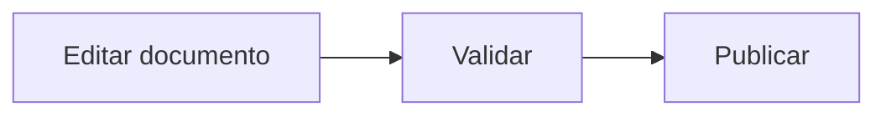

# Guía de contribución y mantenimiento de TuxLab

Este documento reúne los procedimientos técnicos para **desarrollar, editar, validar y publicar TuxLab**. Para conocer el propósito y el contenido del proyecto, consulta el [README.md](README.md).

> **Estado actual:** `dev` es la rama de trabajo y `main` publica la web en <https://karmelo1984.github.io/TuxLab/>. No publiques directamente desde `dev`.

## 1. Requisitos

- Git y un clon del repositorio (no solo el ZIP de GitHub).
- Docker Engine o Docker Desktop, Docker Compose v2 y BuildKit.
- Puerto TCP `8000` libre para desarrollo; `8080` para previsualizar producción.
- Python 3.12 o superior con `venv`, solo para las comprobaciones previas al commit (sección 5).

El entorno de desarrollo está basado en Python 3.12 **dentro del contenedor**: no es necesario instalar Python ni MkDocs en el equipo anfitrión. Las imágenes base permiten construir en `linux/amd64` y `linux/arm64`, incluido Apple Silicon.

## 2. Estructura técnica

```text
TuxLab/
├── .github/
│   └── workflows/
│       ├── lint.yml             # Lint y compilación de documentación
│       └── pages.yml            # Publicación desde main
├── deploy/
│   └── Caddyfile                # Servidor HTTP estático de producción
├── mkdocs/
│   ├── docs/                    # Artículos, recursos, imágenes y .pages
│   └── mkdocs.yml               # Configuración del sitio
├── .dockerignore                # Contexto de las imágenes Docker
├── .gitignore                   # Exclusiones de Git del equipo/proyecto
├── .pre-commit-config.yaml      # Comprobaciones previas al commit
├── Dockerfile                   # Etapas development, site-builder y production
├── docker-compose.yml           # Desarrollo con MkDocs
├── docker-compose.prod.yml      # Publicación estática autoalojada
├── requirements-mkdocs.txt     # Dependencias de Python compartidas
├── README.md                    # Presentación general del proyecto
└── CONTRIBUTING.md              # Este documento
```

Las plantillas `technical-guide.md`, `self-hosting.md`, `script.md` y `prompt.md` se encuentran en `templates/`. La cabecera YAML de cada artículo contiene solo `title` y `description`; `scripts/check_frontmatter.py` lo valida en pre-commit.

## 3. Desarrollo local con Docker

Trabaja sobre `dev` y revisa cualquier cambio local antes de cambiar de rama.

```bash
git status
git switch dev
docker compose config
docker compose up --build -d
```

Accede a <http://127.0.0.1:8000/>.

El contenedor monta **`./mkdocs` en `/mkdocs` como solo lectura** y ejecuta `mkdocs serve` con recarga automática. Los cambios en los archivos Markdown, CSS y configuración se reflejan sin reconstruir la imagen. Las dependencias se instalan durante `docker build`, no al arrancar el contenedor.

### Comandos habituales

```bash
# Estado y registros
docker compose ps
docker compose logs -f mkdocs

# Comprobar usuario y versión
docker compose exec mkdocs id
docker compose exec mkdocs mkdocs --version

# Compilar sin escribir en el volumen del proyecto
docker compose run --rm --no-deps mkdocs \
  mkdocs build --config-file /mkdocs/mkdocs.yml \
  --site-dir /tmp/tuxlab-check

# Detener el servicio
docker compose down
```

Reconstruye la imagen si cambian el `Dockerfile` o `requirements-mkdocs.txt`:

```bash
docker compose up --build -d
```

### Seguridad del entorno de desarrollo

La configuración incluida en `docker-compose.yml` utiliza:

- UID/GID `10001:10001`, sin usuario root.
- Sistema de archivos raíz y volumen de documentación de solo lectura.
- `tmpfs` en `/tmp`, para archivos temporales de MkDocs.
- `cap_drop: ALL` y `no-new-privileges`.
- Puerto publicado únicamente en `127.0.0.1:8000`.

**No expongas `mkdocs serve` directamente a Internet.** Es un servidor de desarrollo, no el servicio web de producción.

## 4. Crear o modificar documentación

1. Selecciona una sección existente de `mkdocs/docs/` o crea un directorio temático cuando corresponda.
2. Parte, cuando sea útil, de una plantilla de `templates/`: `technical-guide.md`, `self-hosting.md`, `script.md` o `prompt.md`.
3. Escribe el contenido en Markdown y guarda los recursos asociados en el directorio de la sección correspondiente.
4. Actualiza el archivo `.pages` de la sección si hace falta modificar el orden, los títulos o la jerarquía de la navegación.
5. Revisa localmente el resultado, incluidos enlaces, iconos, imágenes, tablas y diagramas Mermaid.
6. Ejecuta las validaciones antes de enviar el cambio.

### Criterios editoriales recomendados

- Escribe la documentación del proyecto **en castellano**.
- Usa nombres de archivos descriptivos, preferentemente en minúsculas y con guiones para los nuevos artículos.
- Incluye un encabezado H1 por artículo y emplea H2/H3 de forma jerárquica.
- Explica prerrequisitos, comandos, efectos secundarios y pasos de reversión cuando una operación pueda modificar el sistema.
- Evita secretos, contraseñas, tokens, direcciones privadas y otros datos sensibles; utiliza valores ficticios cuando proceda.
- Conserva las rutas y referencias relativas para no romper la navegación.
- No añadas archivos generados (`site/`), cachés ni metadatos del sistema.
- No elimines ni ignores los archivos `.pages`: son parte de la navegación.

Estas son convenciones de mantenimiento propuestas, no validaciones automáticas adicionales a las existentes.

### Ejemplo: iconos y Markdown avanzado

El tema incluye iconos SVG de Material y Font Awesome. No se utiliza `fontawesome-markdown`.

```markdown
:material-docker: Docker

:material-linux: Linux

:fontawesome-brands-github: GitHub

:fontawesome-solid-triangle-exclamation: Advertencia
```

Las extensiones se configuran en `mkdocs/mkdocs.yml`. No dupliques extensiones ni añadas paquetes nuevos sin actualizarlos también en `requirements-mkdocs.txt`.

### Ejemplo: diagrama Mermaid

Usa un bloque Markdown con lenguaje `mermaid`:



### Navegación

La navegación utiliza el plugin Awesome Pages y archivos `.pages` dentro de `mkdocs/docs/`. Cuando reorganices contenido, consulta primero los `.pages` existentes de esa carpeta y verifica que los enlaces internos siguen funcionando.

## 5. Validaciones y calidad

### Comprobación de compilación con Docker

```bash
docker compose run --rm --no-deps mkdocs \
  mkdocs build --config-file /mkdocs/mkdocs.yml \
  --site-dir /tmp/tuxlab-check
```

### Entorno virtual de Python

Crea el entorno una sola vez, en la raíz del repositorio (`.venv/` está en `.gitignore`):

```bash
python3 -m venv .venv
source .venv/bin/activate
pip install -r requirements-mkdocs.txt pre-commit
pre-commit install
```

Los hooks usan `.venv/bin/mkdocs` directamente, así que `git commit` y `git push` funcionan también desde VS Code sin activar el entorno. Actívalo (`source .venv/bin/activate`) solo para ejecutar `pre-commit` o `mkdocs` a mano.

### Comprobaciones con pre-commit

El repositorio incluye `.pre-commit-config.yaml` con verificaciones de formato, Markdown, YAML y Python. `pre-commit install` registra dos hooks de Git:

- `pre-commit`: linters y formateadores en cada `git commit`.
- `pre-push`: `mkdocs build`, igual que el workflow de Pages, en cada `git push`.

Para ejecutarlos a mano:

```bash
scripts/check.sh
```

El script indexa los cambios (`git add -A`), deja que los hooks con `--fix` corrijan los archivos, vuelve a indexar y verifica con las reglas de `pre-commit` y `pre-push`. Si termina con `OK`, `git commit` no volverá a fallar por correcciones automáticas.

`git commit` comprueba solo lo **indexado**, no el árbol de trabajo. Por eso una ejecución manual puede pasar y el commit fallar si los hooks modifican archivos durante el commit.

`mkdocs/mkdocs.yml` contiene tags de configuración específicos de MkDocs (como `!ENV` y `!!python/name`): su comprobación funcional se realiza con `mkdocs build`, no con el validador YAML genérico de pre-commit.

### GitHub Actions

- `.github/workflows/lint.yml` valida los _pushes_ a `dev` y las _pull requests_. También construye el sitio con las dependencias de `requirements-mkdocs.txt`.
- `.github/workflows/pages.yml` genera y publica el HTML únicamente desde `main`, incluida la ejecución manual del workflow.

Antes de integrar en `main`, comprueba que el workflow de lint ha terminado correctamente y que el resultado local conserva la navegación y el aspecto esperado.

## 6. Flujo de trabajo con Git

1. Realiza los cambios en `dev` (o en una rama de trabajo integrada después en `dev`).
2. Revisa los archivos afectados mediante `git status` y `git diff`.
3. Comprueba la compilación y los linters.
4. Envía los cambios y revisa el workflow **Lint**.
5. Integra los cambios validados en `main`, preferiblemente mediante una _pull request_ con revisión de diferencias.
6. Comprueba la ejecución de **Publicar TuxLab** y el sitio en GitHub Pages.

Ejemplo para cambios ya revisados en `dev`:

```bash
git status
git add README.md CONTRIBUTING.md
git diff --cached
git commit -m "docs: separar documentación de proyecto y contribución"
git push origin dev
```

**No fusiones cambios a `main` únicamente para comprobarlos en producción.** El servidor local y la validación de CI están disponibles para esa finalidad.

## 7. Publicación actual: GitHub Pages

La URL de producción es <https://karmelo1984.github.io/TuxLab/>.

GitHub Actions usa `.github/workflows/pages.yml` para:

1. Descargar `main` con historial Git completo (`fetch-depth: 0`).
2. Instalar Python y los paquetes de `requirements-mkdocs.txt`.
3. Construir HTML con `mkdocs/mkdocs.yml`.
4. Publicar el artefacto en GitHub Pages.

El despliegue **no necesita Docker**. No ejecutes el Compose de producción para publicar en GitHub Pages.

El plugin `git-revision-date-localized` se activa cuando `CI=true` y existe historial Git. Durante el desarrollo Docker queda desactivado porque el volumen `./mkdocs` no contiene `.git`.

## 8. Producción alternativa: servidor propio

La alternativa autoalojada utiliza `docker-compose.prod.yml` y la etapa `production` del `Dockerfile`:

1. `site-builder` compila la documentación estática con MkDocs e historial Git.
2. Se copia el HTML a una imagen final con Caddy.
3. Caddy sirve los archivos en el puerto interno `8080`, sin Python ni MkDocs instalados en la imagen final.

**Requisito:** la construcción necesita un clon Git real con `.git/` y el historial completo para calcular las fechas de modificación. Un ZIP de GitHub no contiene ese historial. El `Dockerfile` final no copia `.git` a Caddy.

### Previsualización local de la imagen de producción

```bash
docker compose -f docker-compose.prod.yml config
SITE_URL=http://localhost:8080/ \
  docker compose -f docker-compose.prod.yml up --build -d

curl -f http://127.0.0.1:8080/healthz
curl -I http://127.0.0.1:8080/

# Al finalizar la prueba
docker compose -f docker-compose.prod.yml down
```

### Despliegue con dominio propio

```bash
SITE_URL=https://docs.tudominio.es/ \
  docker compose -f docker-compose.prod.yml up --build -d
```

Sustituye el dominio de ejemplo por el dominio real. `SITE_URL` se aplica durante el **build**, sin modificar el archivo `mkdocs/mkdocs.yml` del árbol de trabajo; si cambia la URL pública hay que reconstruir la imagen.

Por defecto, el contenedor solo se publica en `127.0.0.1:8080` del host. Para dar acceso público, configura un **proxy inverso con HTTPS**, un certificado TLS válido y las reglas de red necesarias. El archivo `deploy/Caddyfile` gestiona el HTTP interno, la compresión, las cabeceras de seguridad y `/healthz`; no configura HTTPS público por sí solo.

Al ser un sitio estático, **no existe recarga automática en producción**. Después de editar la documentación se debe reconstruir y recrear la imagen:

```bash
SITE_URL=https://docs.tudominio.es/ \
  docker compose -f docker-compose.prod.yml up --build -d
```

No expongas el puerto `8000` de desarrollo al exterior.

## 9. Actualización de dependencias e imágenes

- Mantén las dependencias directas en `requirements-mkdocs.txt`, compartido por Docker y GitHub Actions. No uses instalaciones dinámicas mediante `ADD_MODULES` en el arranque.
- Las versiones directas están fijadas, pero las dependencias transitivas todavía no están bloqueadas mediante hashes: para reproducibilidad completa se requiere un lock y fijar el _digest_ de las imágenes base.
- Actualiza el Dockerfile, prueba la documentación en `dev` y revisa posibles incompatibilidades de Material, Mermaid y Awesome Pages antes de publicar.
- Reconstruye periódicamente las imágenes para incorporar correcciones de seguridad, sin considerar que el multistage por sí solo las garantiza.
- No subas `.env`, credenciales ni ficheros locales de configuración. El `.gitignore` es una ayuda, no sustituye la revisión de los archivos añadidos.

## 10. Solución de problemas

| Síntoma                                            | Comprobación                                                                        |
|----------------------------------------------------|-------------------------------------------------------------------------------------|
| No carga `localhost:8000`                          | Ejecuta `docker compose ps`, revisa el puerto y `docker compose logs -f mkdocs`.    |
| Los cambios Markdown no aparecen                   | Comprueba la ruta `./mkdocs`, el volumen y la recarga del navegador.                |
| Falla la compilación tras cambiar un plugin        | Reconstruye con `docker compose up --build -d` y revisa `requirements-mkdocs.txt`.  |
| No aparecen fechas Git en desarrollo               | Es esperado: el plugin está desactivado en el contenedor local.                     |
| Fallan fechas Git en CI o producción               | Comprueba `CI=true`, `.git/`, el historial y `fetch-depth: 0` en Actions.           |
| Falla el build autoalojado tras descargar un ZIP   | Utiliza un clon Git con historial completo, no un ZIP sin `.git/`.                  |
| No responde el servidor autoalojado desde Internet | Comprueba el proxy HTTPS: el puerto `8080` escucha solo en loopback.                |
| Git sigue mostrando `.DS_Store` u otros archivos   | Comprueba si ya estaban versionados: `.gitignore` no desindexa archivos existentes. |

## 11. Comprobación final antes de fusionar a `main`

- [ ] El sitio se compila sin errores.
- [ ] La navegación `.pages`, los enlaces y las rutas internas funcionan.
- [ ] Se visualizan correctamente Mermaid, iconos, imágenes y estilos.
- [ ] No se han añadido secretos, cachés, archivos del sistema ni artefactos generados.
- [ ] Se han revisado los cambios de formato introducidos por pre-commit.
- [ ] El workflow **Lint** de GitHub Actions pasa correctamente.
- [ ] Se ha revisado la _pull request_ antes de integrar el cambio en `main`.
