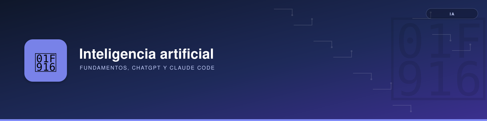

# Inteligencia artificial

Esta sección reúne conocimiento técnico sobre inteligencia artificial generativa: cómo funcionan los modelos de lenguaje, cómo se usan de forma sistemática y cómo se configuran las herramientas de desarrollo basadas en ellos.

No es un manual de interfaces. Las pantallas y los menús cambian con rapidez, por lo que cada página explica conceptos, flujos de trabajo y enlaza la documentación oficial.

| Apartado | Contenido |
|----------|-----------|
| [Fundamentos](fundamentos/index.md) | Modelos, tokens y contexto, prompting, RAG y agentes, evaluación y seguridad |
| [ChatGPT](chatgpt/index.md) | Buenas prácticas de prompting recomendadas por OpenAI |
| [Claude](claude/index.md) | Ecosistema de Claude y Claude Code: reglas, skills, hooks, MCP, subagentes, permisos y costes |

Las funcionalidades de estos productos evolucionan. Cuando una página depende de una versión, lo indica; en caso de duda, prevalece la documentación oficial enlazada en cada artículo.
