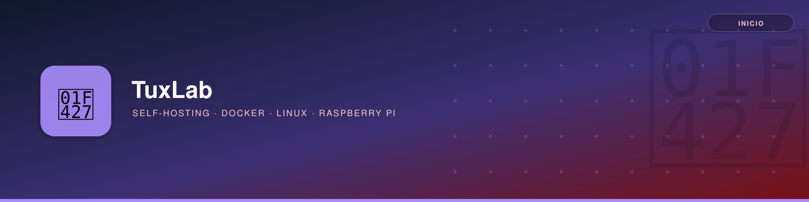

# Bienvenido a TUXLAB

**TuxLab** es un espacio de documentación técnica personal sobre **Entornos Linux basados en Debian** una referencia propia, en constante evolución. Una biblioteca de mis búsquedas más habituales.

## Explora por sección

| Sección                                                       | Contenido                                                                      |
|---------------------------------------------------------------|--------------------------------------------------------------------------------|
| [Self-Hosting](self-hosting/index.md)                         | Jellyfin, Nextcloud, Pi-hole, Portainer y demás apps autohospedadas con Docker |
| [Docker](docker/introduccion.md)                              | Contenedores, imágenes, volúmenes, redes y troubleshooting                     |
| [Linux](linux/index.md)                                       | Redes (SSH, DHCP, DDNS), sistemas de archivos y scripts                        |
| [Raspberry Pi](raspberrypi/raspberrypi.md)                    | Instalación, utilidades, cámara y servidor NAS                                 |
| [Desarrollo](dev/index.md)                                    | Git: fundamentos, flujo para QA y publicación de versiones                     |
| [Proyectos](proyectos/index.md)                               | Proyectos propios con épicas, historias de usuario y diagramas                 |
| [IA](ia/index.md)                                             | Fundamentos de IA, ChatGPT y Claude Code                                       |

## Objetivo

✔ Facilitar la **gestión y mantenimiento de servidores**.
✔ Mejorar la **eficiencia en entornos Linux**.
✔ Servir de **referencia rápida** para configuraciones y comandos ya probados.
✔ Pero sobre todo, pasármelo bien mientras aprendo.

---

📢 _Este sitio se actualiza con nuevos aprendizajes y mejores prácticas. ¡Explora y aprende!_
