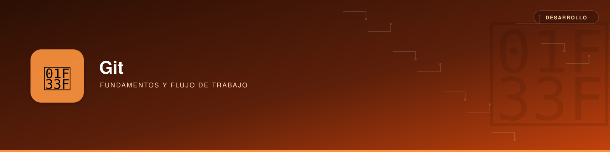

# Guía de Git



**Descripción**: Git es un sistema distribuido de control de versiones. Registra cambios mediante commits, permite trabajar en ramas independientes y facilita la colaboración sin perder la trazabilidad del código.

Esta guía reúne los conceptos y comandos comunes. Los procedimientos específicos se documentan por separado para evitar duplicidades:

- [Trabajo de QA: actualización, limpieza y contribuciones](qa.md).
- [Publicación de versiones: integración de `dev` en `main`](releases.md).

!!! note "Convención de ramas"
    `main` representa las versiones publicadas. En los ejemplos de releases se usa `dev` para desarrollo y en los de QA, `develop`. **`dev` y `develop` no son nombres equivalentes**: utiliza el que exista realmente en el repositorio.

---

## Instalación y configuración

### Instalar Git

=== "Debian / Ubuntu"
    ```bash
    sudo apt update
    sudo apt install git -y
    ```

=== "Fedora"
    ```bash
    sudo dnf install git -y
    ```

=== "macOS"
    ```bash
    brew install git
    ```

=== "Windows"
    Instala Git desde [git-scm.com](https://git-scm.com/downloads/win).

Comprueba la instalación y configura la identidad de los commits:

```bash
git --version
git config --global user.name "Tu Nombre"
git config --global user.email "correo@example.com"
git config --global --list
```

La identidad del commit **no equivale a la autenticación** para hacer `push` a GitHub o GitLab.

### Conceptos esenciales

| Concepto | Significado |
|---|---|
| Repositorio local | Historial Git y archivos de trabajo en el equipo. |
| Remoto (`origin`) | Nombre habitual del repositorio remoto; no es obligatorio. |
| `HEAD` | Referencia al commit actualmente extraído. |
| *Working tree* | Archivos presentes en el directorio de trabajo. |
| Índice (*staging*) | Cambios preparados para el siguiente commit. |
| Commit | Instantánea versionada, con identificador y padre o padres. |
| Rama | Referencia móvil a un commit. |
| Tag | Referencia a un punto concreto del historial, habitualmente una versión. |

---

## Operaciones habituales

### Iniciar o clonar un repositorio

```bash
git init                         # Inicializar un repositorio local
git clone URL_DEL_REPOSITORIO    # Clonar uno existente
```

### Consultar y preparar cambios

```bash
git status                       # Estado de archivos y rama
git diff                         # Cambios no preparados
git add ruta/archivo             # Preparar un archivo concreto
git diff --cached                # Revisar los cambios preparados
git commit -m "docs: actualizar guía"
```

Es preferible indicar archivos concretos en `git add` cuando se quieren evitar cambios accidentales. `git add .` prepara todos los cambios elegibles bajo el directorio actual.

### Consultar el historial

```bash
git log --oneline --graph --decorate --all
git log --oneline -5
git show HEAD
```

### Trabajar con el remoto

```bash
git remote -v                    # Identificar los remotos
git fetch --prune origin          # Actualizar referencias remotas
git pull --ff-only origin main    # Avanzar main solo si es fast-forward
git push origin main              # Publicar commits locales
```

`fetch` **no modifica** la rama actual. `pull` integra cambios remotos; la opción `--ff-only` evita crear un merge implícito y falla si las historias han divergido. No resuelvas un rechazo de `push` con un `pull` indiscriminado: comprueba antes las diferencias de historial.

---

## Ramas y colaboración

### Gestión de ramas

```bash
git branch                              # Ramas locales
git branch -a                           # Locales y remotas conocidas
git switch main                         # Cambiar a una rama local
git switch -c feature/nueva-funcion     # Crear rama y cambiar a ella
git switch -c develop --track origin/develop  # Seguir una rama remota
git branch -d feature/nueva-funcion     # Borrar una rama ya integrada
git merge feature/nueva-funcion         # Fusión convencional
```

Para crear una rama desde el estado remoto de `main` sin cambiar la rama activa:

```bash
git fetch origin main
git branch nueva-rama origin/main
```

### Convención de nombres

| Prefijo | Finalidad | Ejemplo |
|---|---|---|
| `feature/` | Nueva funcionalidad. | `feature/export-csv` |
| `fix/` | Corrección de un defecto. | `fix/null-pointer` |
| `chore/` | Mantenimiento o ajuste técnico. | `chore/improve-log-traceability` |
| `refactor/` | Reestructuración sin cambiar el comportamiento esperado. | `refactor/log-service` |

Son convenciones de equipo, no reglas impuestas por Git.

### Modelos de colaboración

| Modelo | Esquema | Aplicación habitual |
|---|---|---|
| Centralizado | Todos integran en una rama compartida. | Proyectos sencillos y equipos pequeños. |
| Ramas de trabajo (*feature branches*) | Cada cambio se desarrolla en una rama y se revisa mediante Merge Request o Pull Request. | Desarrollo colaborativo y trazable. |
| Gitflow | Ramas `develop`, `feature/*`, `release/*` y `hotfix/*`, además de la principal. | Proyectos con ciclos de publicación diferenciados. |
| Fork y Merge Request | Se proponen cambios desde una copia propia del repositorio. | Colaboradores sin escritura en el repositorio original. |

La integración continua (CI) es **complementaria** a estos modelos: ejecuta validaciones automáticas, pero no constituye por sí misma una estrategia de ramas.

---

## Convención de commits

[Conventional Commits](https://www.conventionalcommits.org/es/v1.0.0/) propone mensajes con una estructura predecible:

```text
<tipo>(<ámbito opcional>): <descripción breve>
```

| Tipo | Uso |
|---|---|
| `feat` | Funcionalidad nueva. |
| `fix` | Corrección de error. |
| `docs` | Documentación. |
| `test` | Pruebas. |
| `refactor` | Refactorización. |
| `perf` | Rendimiento. |
| `style` | Formato sin cambios funcionales. |
| `build` | Construcción o dependencias. |
| `ci` | Integración continua. |
| `chore` | Mantenimiento. |
| `revert` | Reversión de un cambio. |

Ejemplos:

```text
feat(auth): añadir autenticación con JWT
fix(api): corregir la validación de usuarios
docs(git): documentar el proceso de release
```

Esta convención es opcional salvo que el proyecto la establezca. En el [procedimiento de publicación](releases.md) se usa excepcionalmente un mensaje de commit con el número de versión (`v2.0.0`) para identificar la release.

---

## Deshacer cambios y recuperar información

| Necesidad | Comando | Efecto |
|---|---|---|
| Descartar un cambio no preparado | `git restore -- ruta/archivo` | Restaura el archivo desde el índice. |
| Retirar un archivo de staging | `git restore --staged -- ruta/archivo` | Conserva el cambio en el directorio de trabajo. |
| Revertir un commit publicado | `git revert HASH` | Crea otro commit que deshace el cambio. |
| Rehacer el último commit local sin perder cambios | `git reset --soft HEAD~1` | Retrocede un commit conservando el índice. |
| Descartar el último commit y sus cambios locales | `git reset --hard HEAD~1` | Operación destructiva: cambia rama, índice y archivos versionados. |

!!! warning "Operaciones destructivas"
    `git reset --hard` puede eliminar modificaciones locales. La limpieza adicional de archivos no versionados se explica, con precauciones para IntelliJ y Spring Boot, en [Git para QA](qa.md).

Para investigar problemas de historial:

```bash
git reflog                       # Movimientos recientes de HEAD
git diff main dev               # Diferencia entre árboles versionados
git branch -vv                  # Ramas y seguimiento remoto
git status --short --branch
```

---

## Referencias

- [Documentación oficial de Git](https://git-scm.com/docs).
- [Git para QA](qa.md): sincronizar ramas, conservar el entorno local y gestionar permisos GitLab.
- [Publicación de versiones](releases.md): commits de release, `squash`, tags y divergencia de historiales.
