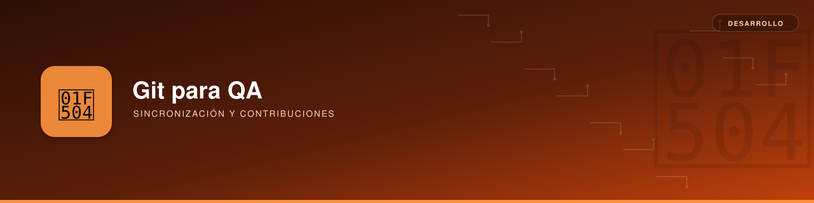

# Git para QA



**Descripción**: procedimientos para mantener actualizado el código de un proyecto Java/Spring Boot desde IntelliJ IDEA, descartar modificaciones locales no deseadas y contribuir con pequeños ajustes técnicos sin perder la configuración del entorno.

Los [comandos generales](git.md) y el [flujo de releases](releases.md) se explican en sus páginas correspondientes.

---

## Antes de limpiar el repositorio

!!! danger "Los comandos de sincronización descartan trabajo local"
    `git reset --hard origin/RAMA` elimina de la rama actual los commits locales no publicados y las modificaciones de archivos versionados. `git clean -fd` elimina archivos y directorios no versionados que **no estén ignorados**. Revisa el resultado antes de ejecutar estos comandos.

```bash
git status --short --branch   # Cambios y rama actual
git clean -nd                 # Simular qué archivos se eliminarían
```

Si necesitas conservar algo, confírmalo en una rama adecuada o guárdalo antes de continuar. `git stash push -u` permite apartar temporalmente cambios versionados y archivos no versionados no ignorados; **no incluye** por defecto archivos ignorados.

### Efecto de cada comando

| Comando | Alcance |
|---|---|
| `git fetch --prune origin` | Actualiza las referencias del remoto y elimina referencias remotas obsoletas; no borra archivos del proyecto. |
| `git reset --hard origin/RAMA` | Iguala el commit de la rama local al remoto y restaura índice y archivos versionados. |
| `git clean -fd` | Borra archivos y directorios no versionados, excepto los ignorados. |
| `git clean -fdx` | **También** borra archivos ignorados; no es apropiado para la limpieza habitual del entorno de desarrollo. |

### Qué ocurre con el entorno de IntelliJ / Spring Boot

| Elemento | Resultado tras `reset --hard` y `clean -fd` |
|---|---|
| Código Java, `pom.xml` y `build.gradle` versionados | Se restauran al estado remoto. |
| Modificaciones preparadas (*staging*) | Se descartan. |
| Commits locales no publicados en la rama | Dejan de estar en su historial (pueden ser recuperables mediante `reflog` durante un tiempo). |
| Archivos nuevos no versionados y no ignorados | Se eliminan. |
| `.idea/`, cachés y artefactos ignorados | Se conservan, si están efectivamente ignorados. |
| Configuración de IntelliJ versionada | Puede sobrescribirse. |
| Variables y ajustes externos al repositorio | No se ven afectados por estos comandos. |

**Importante**: que un archivo parezca «local» no garantiza que Git lo ignore. Verifícalo con `git status` o `git check-ignore -v ruta/archivo`.

---

## Obtener la última versión de `develop`

### Rama `develop` ya existente en local

Ejecuta este procedimiento cuando **puedas descartar todo el trabajo local** de esa rama y no haya modificaciones que impidan cambiarte a ella:

```bash
git switch develop
git fetch --prune origin
git reset --hard origin/develop
git clean -nd              # Vista previa; revisar antes de continuar
git clean -fd
git status
```

Resultado esperado: rama `develop` sincronizada con `origin/develop` y directorio de trabajo limpio, salvo posibles archivos ignorados. No es necesario volver a clonar el proyecto.

Para sincronizar **cualquier rama actual** desde Bash o Zsh puede sustituirse el `reset` específico por:

```bash
git reset --hard "origin/$(git branch --show-current)"
```

La rama correspondiente debe existir en `origin`. Este comando también descarta commits locales no publicados; no lo utilices para una rama personal que quieras conservar.

### Primera vez: `develop` solo existe en el remoto

Si estás en `main` con cambios accidentales y deseas descartarlos antes de pasar a `develop`:

```bash
git status --short --branch
git clean -nd
git reset --hard HEAD
git clean -fd
git fetch --prune origin
git switch -c develop --track origin/develop
git status
```

`git reset --hard HEAD` descarta cambios versionados **sin eliminar commits ya creados** en `main`. Si además quieres igualar `main` con el remoto, ejecuta `git reset --hard origin/main` después del `fetch` y **antes** de cambiar de rama.

!!! note "Cambio de rama bloqueado"
    Si `git switch develop` no permite el cambio por modificaciones locales, conserva o descarta esas modificaciones **en la rama de origen** antes de intentarlo de nuevo. No confíes en que el `reset` de `develop` pueda resolver problemas anteriores al cambio de rama.

---

## Proponer una mejora técnica desde QA

Para cambios como una mejora de trazabilidad de logs, utiliza una rama independiente y una Merge Request de GitLab. Las convenciones de prefijos (`feature/`, `fix/`, `chore/`, `refactor/`) se recogen en la [guía general](git.md#convencion-de-nombres).

**Partiendo de `develop` ya sincronizada y sin cambios pendientes:**

```bash
git switch -c chore/improve-log-traceability

# Modificar únicamente los archivos necesarios en IntelliJ IDEA.
git status
git diff

git add ruta/fichero1.java ruta/fichero2.java
git diff --cached
git commit -m "chore: improve log traceability"
git push -u origin chore/improve-log-traceability
```

A continuación, abre una **Merge Request** hacia la rama de integración definida por el proyecto. Evita incluir archivos de configuración personales y cambios ajenos al objetivo de la rama.

### Error HTTP 403 al publicar en GitLab

```text
remote: You are not allowed to push code to this project.
fatal: unable to access '...': The requested URL returned error: 403
```

El error suele indicar falta de autorización de escritura con las credenciales usadas. Comprueba también la autenticación, el ámbito del token, las restricciones del proyecto y la protección de ramas. No significa que el commit local se haya perdido.

Alternativas, según las políticas de la organización:

1. Solicitar permisos apropiados (habitualmente rol `Developer`, aunque puede haber restricciones adicionales).
2. Publicar el cambio en un **fork** y abrir una Merge Request, si está permitido.
3. Entregar un parche a una persona con permisos de escritura:

```bash
git format-patch -1 HEAD       # Genera un .patch del último commit
```

El destinatario puede aplicarlo mediante `git am nombre-del-parche.patch` desde el repositorio de destino, revisando previamente su contenido y compatibilidad.

---

## Comandos de diagnóstico

| Comando | Utilidad |
|---|---|
| `git status` | Rama actual, staging y modificaciones. |
| `git branch -a` | Ramas locales y referencias remotas. |
| `git branch -vv` | Seguimiento y diferencias respecto al remoto. |
| `git diff` | Cambios sin preparar. |
| `git diff --cached` | Cambios preparados para commit. |
| `git log --oneline -5` | Últimos cinco commits. |
| `git remote -v` | Dirección del remoto usado. |
| `git clean -nd` | Previsualización de archivos no versionados que serían eliminados. |
| `git check-ignore -v RUTA` | Regla que provoca que se ignore un archivo. |

**Regla operativa**: primero verifica la rama y el estado local; sincroniza con el remoto únicamente si puedes descartar esos cambios. Para contribuir, crea una rama de trabajo y revisa los archivos preparados antes de confirmar el commit.

**Referencia**: [documentación oficial de `git-reset`](https://git-scm.com/docs/git-reset) y [`git-clean`](https://git-scm.com/docs/git-clean).
