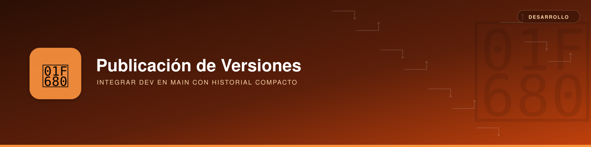

# Publicación de versiones: `dev` → `main`



**Descripción**: procedimiento para publicar en `main` el estado final de `dev` mediante **un único commit por versión**, conservando el historial detallado del desarrollo en `dev`.

En esta página se usa `dev` como rama de desarrollo. Si tu repositorio utiliza `develop`, sustituye el nombre en los comandos; ambas ramas no son intercambiables automáticamente.

---

## Objetivo y modelo de ramas

| Rama | Responsabilidad | Historial deseado |
|---|---|---|
| `dev` | Desarrollo y commits intermedios. | Completo y detallado. |
| `main` | Estados publicados y tags de release. | Un commit representativo por versión. |

Partiendo de un commit común `A`, el desarrollo puede contener varios cambios:

```text
A                    main (v1.0.1)
 \
  B ── C ── D        dev (v2.0.0 preparada)
```

Tras publicar `v2.0.0` mediante squash, `main` contiene un commit nuevo `E` cuyo padre es `A`, pero **no incorpora `B`, `C` y `D` como antepasados**:

```text
A ── E                main, tag v2.0.0
 \
  B ── C ── D         dev
```

Aunque `D` y `E` tengan el mismo árbol de archivos, son commits diferentes y Git conserva dos genealogías.

---

## Primera publicación mediante `merge --squash`

**Requisitos**: permisos para publicar en `main`, ramas locales actualizadas, pruebas de la versión superadas y directorio de trabajo limpio. Si `main` está protegida, el procedimiento deberá realizarse con el proceso de revisión/publicación autorizado.

```bash
# Actualizar desarrollo.
git switch dev
git pull --ff-only origin dev

# Actualizar la rama de publicación.
git switch main
git pull --ff-only origin main
git status --short

# Aplicar el conjunto de cambios sin registrar un merge convencional.
git merge --squash dev

# Revisar el contenido preparado y crear un único commit de versión.
git diff --cached --check
git diff --cached --stat
git commit -m "v2.0.0"
```

`git merge --squash dev` calcula la integración utilizando el ancestro común, actualiza el índice y el directorio de trabajo, pero **no crea el commit ni registra una relación de merge**. El commit posterior tiene un solo padre en `main`.

!!! warning "Conflictos o cambios no deseados"
    Un squash puede presentar conflictos o producir un contenido diferente de `dev` cuando `main` contiene cambios propios. Resuélvelos y revisa el resultado antes de confirmar. Si la operación no termina, **no publiques la release**.

### Verificar que ambos árboles son iguales

Cuando el objetivo es publicar **exactamente** el contenido versionado de `dev`:

```bash
git diff --exit-code main dev
git rev-parse 'main^{tree}'
git rev-parse 'dev^{tree}'
```

`git diff --exit-code` no muestra diferencias y devuelve código 0 si los árboles coinciden. Los dos valores `tree` deben tener el mismo hash. Esto **no implica** que los commits de `main` y `dev` tengan el mismo identificador o historial.

### Crear y publicar la etiqueta de release

```bash
git push origin main
git tag -a v2.0.0 main -m "Release v2.0.0"
git push origin v2.0.0
```

La *annotated tag* `v2.0.0` identifica expresamente el commit de `main`, aunque la rama activa fuera otra. Publícala después de verificar el commit de release y de confirmar que se ha publicado `main`.

---

## Releases posteriores sin realinear `dev`

**Decisión adoptada**: seguir desarrollando en `dev` después de publicar cada versión, sin ejecutar `reset --hard main` sobre ella. `dev` mantiene todos sus commits; `main`, un commit por release.

!!! important "No repetir `merge --squash` a ciegas"
    El primer squash **no registra** que `main` ya incorporó los cambios anteriores de `dev`. En la siguiente versión, el ancestro común continúa siendo el anterior al squash. Repetir `git merge --squash dev` puede volver a procesar cambios ya publicados y provocar conflictos, incluso de tipo `add/add`.

Para publicaciones posteriores que requieren que `main` sea **una instantánea exacta** del último estado versionado de `dev`, es más predecible actualizar los archivos de `main` directamente desde el árbol de `dev`. El resultado sigue siendo **un único commit de release con un solo padre**, aunque técnicamente este paso **no es un comando `merge --squash`**.

```bash
# Preparar ambas ramas: sin modificaciones locales pendientes.
git switch dev
git pull --ff-only origin dev
git switch main
git pull --ff-only origin main
git status --short

# Copiar el árbol versionado de dev a índice y directorio de main.
git restore --source=dev --staged --worktree -- :/

# Validar y confirmar la nueva instantánea.
git diff --cached --check
git diff --cached --stat
git commit -m "v2.1.0"

# Comprobar la igualdad exacta antes de publicar.
git diff --exit-code main dev

git push origin main
git tag -a v2.1.0 main -m "Release v2.1.0"
git push origin v2.1.0
```

`git restore ... :/` se aplica a todo el repositorio, incluidos archivos versionados nuevos, modificados y eliminados en `dev`. Por ello **debe ejecutarse sobre una `main` limpia**, y después hay que revisar y probar el resultado. No conserva cambios exclusivos de `main` si no existen en `dev`; esos cambios deben incorporarse deliberadamente al desarrollo antes de publicar.

Si no hay ninguna diferencia entre los árboles, `git commit` no creará una nueva versión por defecto. Asegúrate de que la nueva release contenga cambios reales antes de continuar.

### Resultado acumulado

```text
A ── E ── H                  main (E=v2.0.0, H=v2.1.0)
 \
  B ── C ── D ── F ── G       dev (historial detallado)
```

Los commits `E` y `H` son instantáneas publicadas, sin que `main` haya adquirido los commits individuales de `dev` como padres.

---

## Alternativa: realinear `dev` con `main`

Realinear `dev` tras cada publicación permite comenzar el ciclo siguiente desde el commit de la release. De esa forma, futuros `merge --squash` vuelven a partir de una base común reciente. **No es la estrategia elegida en esta guía**.

```bash
# Solo si el equipo ha aprobado reescribir la rama dev.
git switch dev
git status
git branch backup/dev-antes-de-realinear dev
git reset --hard main

# Si dev ya existe en remoto y está permitido reescribirla:
git push --force-with-lease origin dev
```

!!! danger "Reescritura de historial compartido"
    `reset --hard` destruye modificaciones locales sin confirmar, y mueve `dev` para que apunte al commit de `main`. Sus commits exclusivos dejan de ser accesibles por el nombre de la rama. `--force-with-lease` protege ante algunas actualizaciones remotas inesperadas, **pero no sustituye la coordinación del equipo** y puede estar prohibido por las reglas de GitLab. La rama de respaldo anterior solo se conserva localmente mientras no se publique.

Después de realinear, ambas ramas apuntarían inicialmente al mismo commit:

```text
A ── E                  main, dev, tag v2.0.0
```

---

## Criterio de elección

| Situación | Procedimiento |
|---|---|
| Primera publicación desde ramas con un ancestro común adecuado | `git merge --squash dev` + commit de versión. |
| Nuevas versiones sin realinear `dev` y con exigencia de árboles idénticos | `git restore --source=dev --staged --worktree -- :/` + commit de versión. |
| Se decide reescribir `dev` y todos los colaboradores están coordinados | Realinear `dev` con `main` después de la release; siguientes squash con nueva base común. |

**Principio final**: `dev` conserva la trazabilidad del desarrollo; `main` registra los estados publicados. La igualdad del código se comprueba comparando árboles, no asumiendo que sus historiales son iguales.

**Referencias**: [`git-merge`](https://git-scm.com/docs/git-merge), [`git-restore`](https://git-scm.com/docs/git-restore), [`git-tag`](https://git-scm.com/docs/git-tag).
