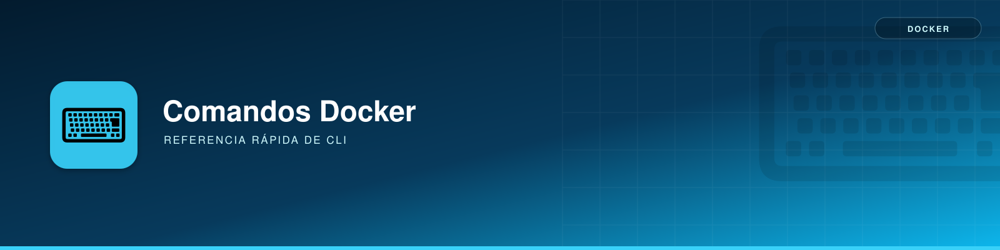

---
authors:
  - Carmelo Molero Castillo
date: 2025-03-19
---

# Comandos esenciales de Docker



Estos son algunos de los comandos más utilizados en Docker:

### Limpiar Contenedores
```bash
docker container prune
```
Elimina todos los contenedores detenidos.

### Limpiar Imágenes
```bash
docker image prune -a
```
Elimina todas las imágenes no utilizadas.

### Limpiar Caché
```bash
docker system prune -f
```
Elimina volúmenes, redes y caché sin preguntar confirmación.

### Eliminar Todo (Cuidado)
```bash
docker system prune -a --volumes
```
Elimina todos los contenedores, imágenes y volúmenes no utilizados.
