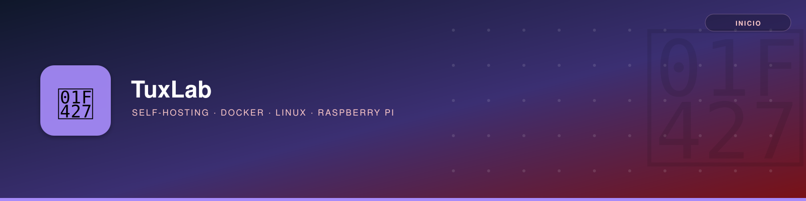

# Bienvenido a TUXLAB

**TuxLab** es un espacio de documentación técnica personal sobre **Self-Hosting**, **Docker**, **Linux** y **Raspberry Pi**: una referencia propia, en constante evolución, para no volver a buscar dos veces lo que ya resolví una.

## 🗂️ Explora por sección

| Sección | Contenido |
|---------|-----------|
| 🔧 [Self-Hosting](self-hosting/centro_multimedia/centro_multimedia.md) | Jellyfin, Nextcloud, Pi-hole, Portainer y demás apps autohospedadas con Docker |
| 🐳 [Docker](docker/introduccion.md) | Contenedores, imágenes, volúmenes, redes y troubleshooting |
| 🐧 [Linux](linux/redes/ssh/ssh.md) | Redes (SSH, DHCP, DDNS), sistemas de archivos y scripts |
| 🍓 [Raspberry Pi](raspberrypi/raspberrypi.md) | Instalación, utilidades, cámara y servidor NAS |

## 🚀 Objetivo

✔ Facilitar la **gestión y mantenimiento de servidores**.
✔ Mejorar la **eficiencia en entornos Linux**.
✔ Servir de **referencia rápida** para configuraciones y comandos ya probados.
✔ Pero sobre todo, pasármelo bien mientras aprendo.

---

📢 *Este sitio se actualiza periódicamente con nuevos aprendizajes y mejores prácticas. ¡Explora y aprende!*
