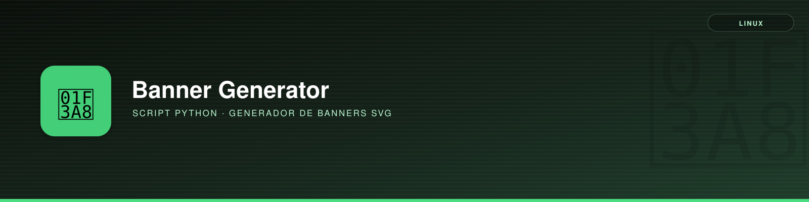

# banner_generator



## Descripción

Genera los banners SVG (1600×400 por defecto) usados como cabecera en todas las páginas de TuxLab: insignia de icono, título, subtítulo, marca de agua grande del icono, etiqueta de categoría y barra de acento inferior. El catálogo completo de banners del sitio (más de 60, uno por página) está definido en `scripts/banners.yml`; este script los genera o regenera a partir de ahí.

---

## Uso

```bash
# Regenerar TODOS los banners del sitio a partir del manifiesto
python banner_generator.py manifest banners.yml

# Regenerar solo los que coincidan con una subcadena en 'out' o 'title'
python banner_generator.py manifest banners.yml --only pihole

# Generar un banner suelto, sin pasar por el manifiesto
python banner_generator.py one \
  --out ../../../dev/git/img/img-git-header-02.svg \
  --title "Git" --subtitle "FUNDAMENTOS Y FLUJO DE TRABAJO" \
  --icon "🌿" --tag Desarrollo \
  --bg-from "#2b0f05" --bg-mid "#5c1f0a" --bg-to "#c2410c" \
  --accent "#fb923c" --accent-light "#fed7aa" --motif circuit
```

**Parámetros (subcomando `manifest`):**

- `manifest`: ruta al fichero `banners.yml` (posicional, obligatorio).
- `--only`: filtra las entradas a generar por subcadena en `out` o `title`.
- `--base-dir`: directorio contra el que resolver las rutas `out` del manifiesto. Por defecto, la raíz `docs/` de MkDocs (calculada desde la ubicación del propio script).

**Parámetros (subcomando `one`):**

- `--out` *(obligatorio)*: ruta de salida del `.svg`, relativa al directorio actual.
- `--title`, `--subtitle`, `--icon`, `--tag` *(obligatorios)*: textos del banner. `--icon` es un emoji.
- `--bg-from`, `--bg-mid`, `--bg-to` *(obligatorios)*: degradado de fondo, en hexadecimal.
- `--accent`, `--accent-light` *(obligatorios)*: color de la insignia/acentos.
- `--motif`: `dots` | `grid` | `circuit` | `scan` | `raspi` | `none` (por defecto `dots`).
- `--width`, `--height`: por defecto `1600`×`400`.
- `--md`: ruta del `.md` destino, solo para calcular la ruta relativa de la línea de incrustado sugerida al final.

El script **solo genera las imágenes**; no modifica ningún fichero Markdown. Al terminar, `one` imprime la línea `` sugerida para pegar a mano bajo el `#` de la página.

---

## Dependencias

- Python ≥ 3.8
- PyYAML (solo para el subcomando `manifest`)

---

## Requisitos

- Ejecutarlo desde `scripts/`, o ajustar `--base-dir` si se mueve de sitio.
- El manifiesto `banners.yml` vive junto al script, en la misma carpeta `scripts/`.

---

## Funcionalidad

- Dibuja un banner SVG homogéneo: insignia de icono a la izquierda, título + subtítulo, marca de agua grande del icono a la derecha, etiqueta de categoría arriba a la derecha y barra de acento inferior.
- Modo `manifest`: lee `banners.yml` y (re)genera cada entrada definida, creando las carpetas `img/` que falten.
- Modo `one`: genera un banner puntual a partir de parámetros de línea de comandos, sin tocar el manifiesto.
- Valida que el `motif` indicado sea uno de los soportados y que no falte ningún campo obligatorio en una entrada del manifiesto.

---

## El manifiesto `banners.yml`

Cada entrada admite estos campos:

| Campo | Obligatorio | Significado |
|---|---|---|
| `md` | no | Ruta del `.md` asociado, relativa a `docs/` (informativa). |
| `out` | sí | Ruta de salida del `.svg`, relativa a `docs/`. |
| `title` | sí | Texto grande del banner. |
| `subtitle` | sí | Texto pequeño en mayúsculas bajo el título. |
| `icon` | sí | Un emoji. |
| `tag` | sí | Etiqueta de categoría (arriba a la derecha): `Self-Hosting`, `Docker`, `Linux`, `Raspberry Pi`, `Desarrollo`, `Proyectos`, `Inicio`. |
| `bg_from` / `bg_mid` / `bg_to` | sí | Degradado de fondo, en hexadecimal. |
| `accent` / `accent_light` | sí | Color de la insignia del icono y de los acentos. |
| `motif` | no | `dots` \| `grid` \| `circuit` \| `scan` \| `raspi` \| `none` (por defecto `dots`). |
| `width` / `height` | no | Por defecto `1600`×`400`. |

Para añadir un banner a una página nueva: añade una entrada al final de `banners.yml`, ejecuta `manifest` con `--only <algo único de esa entrada>` y pega en el `.md` la línea `` que indica la salida del script justo debajo del `#` del título.

!!! note "`self-hosting/centro_multimedia`"
    El banner de `centro_multimedia.md` tiene un diseño propio (tres columnas de servicios) y no está en el manifiesto; se mantiene a mano directamente en su `.svg`.

---

## Ejemplo

```bash
cd docs/linux/script/python/banner_generator/scripts
python banner_generator.py manifest banners.yml --only sshfs
```

```text
OK  .../docs/linux/sistemas-archivos/sshfs/img/img-sshfs-header-01.svg

Total generados: 1
```

---

## Notas

- Los SVG se renderizan en cualquier navegador vía la fuente de emoji del sistema; previsualizadores sin esa fuente (como `cairosvg` en un entorno headless) pueden mostrar el icono como un cuadro vacío — no es un fallo del banner.
- El tamaño típico resultante es de pocos KB por banner, frente a los cientos de KB o varios MB de las imágenes raster que sustituyen.

---

## Script

```python
#!/usr/bin/env python3
"""Generador de banners SVG para las cabeceras de TuxLab.

Produce banners homogéneos (1600x400 por defecto): insignia de icono a la
izquierda, título + subtítulo, marca de agua grande del icono, etiqueta de
categoría arriba a la derecha y barra de acento inferior.

Dos modos de uso:

  1) Manifiesto (recomendado para mantenimiento):
       python banner_generator.py manifest banners.yml
       python banner_generator.py manifest banners.yml --only pihole

  2) Banner suelto (para un caso puntual):
       python banner_generator.py one \
         --out ../../../dev/git/img/img-git-header-01.svg \
         --title "Git" --subtitle "FUNDAMENTOS Y FLUJO DE TRABAJO" \
         --icon "🌿" --tag Desarrollo \
         --bg-from "#2b0f05" --bg-mid "#5c1f0a" --bg-to "#c2410c" \
         --accent "#fb923c" --accent-light "#fed7aa" --motif circuit

El script solo genera las imágenes SVG; no modifica los ficheros Markdown.
Al terminar, imprime la línea `` sugerida para incrustar en la
página correspondiente.
"""

import argparse
import html
import os
import sys

try:
    import yaml
except ImportError:
    yaml = None

DEFAULT_W, DEFAULT_H = 1600, 400

MOTIFS = ("dots", "grid", "circuit", "scan", "raspi", "none")


def _motif_svg(motif, w, h):
    if motif == "dots":
        circles = "".join(
            f'<circle cx="{900 + (i % 10) * 70}" cy="{60 + (i // 10) * 70}" r="3" fill="#ffffff"/>'
            for i in range(60)
        )
        return f'<g opacity="0.12">{circles}</g>'
    if motif == "grid":
        lines = []
        for x in range(900, w, 60):
            lines.append(f'<line x1="{x}" y1="0" x2="{x}" y2="{h}" stroke="#ffffff" stroke-width="1"/>')
        for y in range(0, h, 60):
            lines.append(f'<line x1="900" y1="{y}" x2="{w}" y2="{y}" stroke="#ffffff" stroke-width="1"/>')
        return f'<g opacity="0.06">{"".join(lines)}</g>'
    if motif == "circuit":
        paths = []
        for i in range(10):
            x0 = 900 + (i * 65) % (w - 900)
            y0 = 30 + (i * 53) % (h - 60)
            x1 = x0 + 60
            y1 = y0 + (20 if i % 2 == 0 else -20)
            paths.append(f'<path d="M{x0},{y0} L{x1},{y0} L{x1},{y1}" stroke="#ffffff" stroke-width="2" fill="none"/>')
            paths.append(f'<circle cx="{x1}" cy="{y1}" r="3" fill="#ffffff"/>')
        return f'<g opacity="0.14">{"".join(paths)}</g>'
    if motif == "scan":
        rects = "".join(f'<rect x="0" y="{y}" width="{w}" height="2" fill="#ffffff"/>' for y in range(0, h, 8))
        return f'<g opacity="0.035">{rects}</g>'
    if motif == "raspi":
        pins = []
        for row in range(2):
            for col in range(20):
                pins.append(f'<circle cx="{980 + col * 30}" cy="{140 + row * 30}" r="5" fill="#ffffff"/>')
        return f'<g opacity="0.1">{"".join(pins)}</g>'
    return ""


def _tag_pad(tag):
    return max(0, (len(tag) - 10) * 8)


def render_banner(
    title, subtitle, icon, tag,
    bg_from, bg_mid, bg_to, accent, accent_light,
    motif="dots", width=DEFAULT_W, height=DEFAULT_H,
):
    """Devuelve el contenido SVG (str) de un banner."""
    if motif not in MOTIFS:
        raise ValueError(f"motif debe ser uno de {MOTIFS}, recibido: {motif!r}")

    title = html.escape(title, quote=True)
    subtitle = html.escape(subtitle, quote=True)
    tag_u = html.escape(tag.upper(), quote=True)
    tp = _tag_pad(tag_u)
    motif_svg = _motif_svg(motif, width, height)

    return f'''<svg xmlns="http://www.w3.org/2000/svg" viewBox="0 0 {width} {height}" width="{width}" height="{height}" font-family="'Segoe UI', Helvetica, Arial, sans-serif">
  <defs>
    <linearGradient id="bg" x1="0" y1="0" x2="1" y2="1">
      <stop offset="0%" stop-color="{bg_from}"/>
      <stop offset="55%" stop-color="{bg_mid}"/>
      <stop offset="100%" stop-color="{bg_to}"/>
    </linearGradient>
    <filter id="soft" x="-30%" y="-30%" width="160%" height="160%">
      <feDropShadow dx="0" dy="3" stdDeviation="5" flood-color="#000000" flood-opacity="0.35"/>
    </filter>
  </defs>

  <rect width="{width}" height="{height}" fill="url(#bg)"/>
  {motif_svg}

  <text x="{width - 160}" y="{height / 2 + 90}" text-anchor="middle" font-size="340" opacity="0.10">{icon}</text>

  <g filter="url(#soft)">
    <rect x="80" y="{height / 2 - 70}" width="140" height="140" rx="28" fill="{accent}" opacity="0.9"/>
  </g>
  <text x="150" y="{height / 2 + 28}" text-anchor="middle" font-size="76">{icon}</text>

  <text x="260" y="{height / 2 - 6}" fill="#ffffff" font-size="46" font-weight="700">{title}</text>
  <text x="262" y="{height / 2 + 30}" fill="{accent_light}" font-size="17" letter-spacing="2.5">{subtitle}</text>

  <rect x="{width - 200 - tp}" y="28" width="{170 + tp}" height="34" rx="17" fill="#000000" opacity="0.25" stroke="{accent_light}" stroke-width="1"/>
  <text x="{width - 115 - tp // 2}" y="51" text-anchor="middle" fill="{accent_light}" font-size="13" font-weight="600" letter-spacing="2">{tag_u}</text>

  <rect x="0" y="{height - 6}" width="{width}" height="6" fill="{accent}"/>
</svg>
'''


REQUIRED_FIELDS = (
    "out", "title", "subtitle", "icon", "tag",
    "bg_from", "bg_mid", "bg_to", "accent", "accent_light",
)


def write_entry(entry, base_dir):
    missing = [f for f in REQUIRED_FIELDS if f not in entry]
    if missing:
        raise ValueError(f"Faltan campos {missing} en la entrada: {entry}")

    out_path = os.path.normpath(os.path.join(base_dir, entry["out"]))
    svg = render_banner(
        title=entry["title"],
        subtitle=entry["subtitle"],
        icon=entry["icon"],
        tag=entry["tag"],
        bg_from=entry["bg_from"],
        bg_mid=entry["bg_mid"],
        bg_to=entry["bg_to"],
        accent=entry["accent"],
        accent_light=entry["accent_light"],
        motif=entry.get("motif", "dots"),
        width=entry.get("width", DEFAULT_W),
        height=entry.get("height", DEFAULT_H),
    )
    os.makedirs(os.path.dirname(out_path), exist_ok=True)
    with open(out_path, "w", encoding="utf-8") as fh:
        fh.write(svg)

    md_hint = entry.get("md")
    embed_hint = f"![{entry['title']}]({os.path.relpath(out_path, os.path.dirname(os.path.join(base_dir, md_hint))) if md_hint else entry['out']})"
    return out_path, embed_hint


def cmd_manifest(args):
    if yaml is None:
        sys.exit("Falta PyYAML. Instala con: pip install pyyaml")

    manifest_path = args.manifest
    # Las rutas 'out' del manifiesto son relativas a la raíz docs/ de MkDocs,
    # no al directorio donde vive el manifiesto. Por defecto se asume que el
    # propio script vive en docs/linux/script/python/banner_generator/scripts/.
    if args.base_dir:
        base_dir = os.path.abspath(args.base_dir)
    else:
        script_dir = os.path.dirname(os.path.abspath(__file__))
        base_dir = os.path.normpath(os.path.join(script_dir, "..", "..", "..", "..", ".."))
    with open(manifest_path, encoding="utf-8") as fh:
        data = yaml.safe_load(fh) or {}

    entries = data.get("banners", [])
    if args.only:
        entries = [e for e in entries if args.only in e.get("out", "") or args.only in e.get("title", "")]
        if not entries:
            sys.exit(f"Ningún banner coincide con --only {args.only!r}")

    for entry in entries:
        out_path, embed_hint = write_entry(entry, base_dir)
        print(f"OK  {out_path}")
    print(f"\nTotal generados: {len(entries)}")


def cmd_one(args):
    entry = {
        "out": args.out,
        "title": args.title,
        "subtitle": args.subtitle,
        "icon": args.icon,
        "tag": args.tag,
        "bg_from": args.bg_from,
        "bg_mid": args.bg_mid,
        "bg_to": args.bg_to,
        "accent": args.accent,
        "accent_light": args.accent_light,
        "motif": args.motif,
        "width": args.width,
        "height": args.height,
        "md": args.md,
    }
    out_path, embed_hint = write_entry(entry, base_dir=os.getcwd())
    print(f"OK  {out_path}")
    print(f"\nLínea para incrustar en el Markdown:\n  {embed_hint}")


def build_parser():
    p = argparse.ArgumentParser(description=__doc__, formatter_class=argparse.RawDescriptionHelpFormatter)
    sub = p.add_subparsers(dest="command", required=True)

    p_manifest = sub.add_parser("manifest", help="Genera todos los banners definidos en un fichero YAML")
    p_manifest.add_argument("manifest", help="Ruta al fichero banners.yml")
    p_manifest.add_argument("--only", help="Filtra por subcadena en 'out' o 'title'")
    p_manifest.add_argument(
        "--base-dir",
        help="Directorio base contra el que resolver 'out' (por defecto, la raíz docs/ de MkDocs)",
    )
    p_manifest.set_defaults(func=cmd_manifest)

    p_one = sub.add_parser("one", help="Genera un único banner a partir de parámetros")
    p_one.add_argument("--out", required=True, help="Ruta de salida del .svg (relativa al cwd)")
    p_one.add_argument("--title", required=True)
    p_one.add_argument("--subtitle", required=True)
    p_one.add_argument("--icon", required=True, help="Emoji del icono, p. ej. '🌿'")
    p_one.add_argument("--tag", required=True, help="Etiqueta de categoría, p. ej. 'Desarrollo'")
    p_one.add_argument("--bg-from", dest="bg_from", required=True)
    p_one.add_argument("--bg-mid", dest="bg_mid", required=True)
    p_one.add_argument("--bg-to", dest="bg_to", required=True)
    p_one.add_argument("--accent", required=True)
    p_one.add_argument("--accent-light", dest="accent_light", required=True)
    p_one.add_argument("--motif", choices=MOTIFS, default="dots")
    p_one.add_argument("--width", type=int, default=DEFAULT_W)
    p_one.add_argument("--height", type=int, default=DEFAULT_H)
    p_one.add_argument("--md", help="Ruta del .md destino, solo para calcular la ruta relativa de la sugerencia de incrustado")
    p_one.set_defaults(func=cmd_one)

    return p


def main():
    args = build_parser().parse_args()
    args.func(args)


if __name__ == "__main__":
    main()
```
