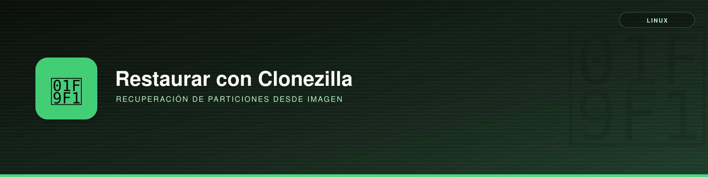

# Restauración de Particiones desde Imágenes de Clonezilla



**Descripción**:  
Detalle del proceso de restauración de particiones desde imágenes creadas con Clonezilla. Sirve para recuperar la estructura original de un disco con particiones del sistema y datos, facilitando la restauración de sistemas operativos o entornos de trabajo.

**Características principales**:  
- ✅ **Descompresión de imágenes** - Restauración de archivos de imagen comprimidos de Clonezilla.  
- ✅ **Recreación de la tabla de particiones** - Uso de `sgdisk` para replicar la estructura original.  
- ✅ **Montaje y restauración de datos** - Uso de dispositivos de bucle (`losetup`) y `dd` para volcar los datos en la imagen final.  

---

## Instalación

### Requisitos previos
- 📌 **Sistema operativo compatible**: Linux/macOS con soporte para `losetup`, `sgdisk` y `dd`.
- 📌 **Dependencias**: Herramientas como `gunzip`, `sgdisk` y `dd`.
- 📌 **Acceso**: Se requieren permisos de superusuario para manipular dispositivos de bucle.

---

## Procedimiento de Restauración

### Paso 1: Descomprimir las Imágenes de Clonezilla
Las imágenes de Clonezilla suelen estar divididas en partes comprimidas. Para reconstruirlas:

```bash
$ cat sda1.vfat-ptcl-img.gz.* | gunzip -c > sda1.img
$ cat sda2.dd-img.* | gunzip -c > sda2.img
$ cat sda3.ntfs-ptcl-img.gz.* | gunzip -c > sda3.img
```

> 📌 **Nota:**  
> - `sda1.img`: Partición EFI (vfat/FAT32).  
> - `sda2.img`: Partición reservada de Microsoft.  
> - `sda3.img`: Partición de datos (NTFS).  

---

### Paso 2: Revisar la Tabla de Particiones Original
Ejecutar:

```bash
$ sgdisk -p /dev/sda
```

Esto mostrará la estructura de particiones original, que debe replicarse.  
```textplain
Disk /dev/sda: 250069680 sectors, 119.2 GiB  
Logical sector size: 512 bytes  
Disk identifier (GUID): B79C5366-C539-4B9C-AF29-FA91E6A1960A  
Partition table holds up to 128 entries  
First usable sector is 34, last usable sector is 250069646  
Partitions will be aligned on 2048-sector boundaries  
Total free space is 6112 sectors (3.0 MiB)  

Number  Start (sector)    End (sector)  Size       Code  Name  
   1            2048          206847   100.0 MiB   EF00  EFI system partition  
   2          206848          239615   16.0 MiB    0C01  Microsoft reserved ...  
   3          239616       249023116   118.6 GiB   0700  Basic data partition  
   4       249024512       250066943   509.0 MiB   2700  
```

---

### Paso 3: Crear una Imagen de Disco Vacía

```bash
$ dd if=/dev/zero of=exterior.img bs=1M count=122880
```

🔹 **Explicación**: Crea una imagen vacía de 119.2 GiB, donde se recreará la estructura de ficheros recuperada.

---

### Paso 4: Crear la Tabla de Particiones GPT en la Imagen

```bash
$ sgdisk --new=1:2048:206847 --typecode=1:EF00 \
       --new=2:206848:239615 --typecode=2:0C01 \
       --new=3:239616:249023116 --typecode=3:0700 \
       --new=4:249024512:250066943 --typecode=4:2700 exterior.img
```
```
Crea 4 particiones con los tamaños y códigos adecuados.
* Partición 1 : 100 MiB (EFI system partition).
* Partición 2 : 16 MiB (Microsoft reserved).
* Partición 3 : 118.6 GiB (Basic data partition).
* Partición 4 : 509 MiB.
```


---

### Paso 5: Montar la Imagen como un Dispositivo de Bucle

```bash
$ sudo losetup -fP exterior.img
$ lsblk -f
```

Esto mostrará las particiones asignadas al dispositivo de bucle (`loopX`).

---

### Paso 6: Copiar las Imágenes de Partición en la Imagen de Disco

```bash
$ sudo dd if=sda1.img of=/dev/loopXp1 bs=4M status=progress
$ sudo dd if=sda2.img of=/dev/loopXp2 bs=4M status=progress
$ sudo dd if=sda3.img of=/dev/loopXp3 bs=4M status=progress
$ sudo dd if=sda4.img of=/dev/loopXp4 bs=4M status=progress
```

---

### Paso 7: Formatear las Particiones (Opcional)
Si es necesario formatear las particiones antes de restaurar datos:

```bash
$ sudo mkfs.vfat /dev/loopXp1   # EFI
$ sudo mkfs.ntfs /dev/loopXp3   # Datos
$ sudo mkfs.ntfs /dev/loopXp4   # Recuperación
```

---

### Paso 8: Desmontar y Liberar el Dispositivo de Bucle

```bash
$ sudo umount /dev/loopXp*
$ sudo losetup -d /dev/loopX
```

---

## Solución de Problemas

**Error: No se puede montar el dispositivo de bucle**  
🔹 Solución: Asegúrate de que `losetup -fP exterior.img` se ejecutó correctamente y revisa con `lsblk`.

**Error: "dd: No space left on device"**  
🔹 Solución: Verifica que la imagen `exterior.img` tenga el tamaño adecuado y que las particiones estén bien definidas.