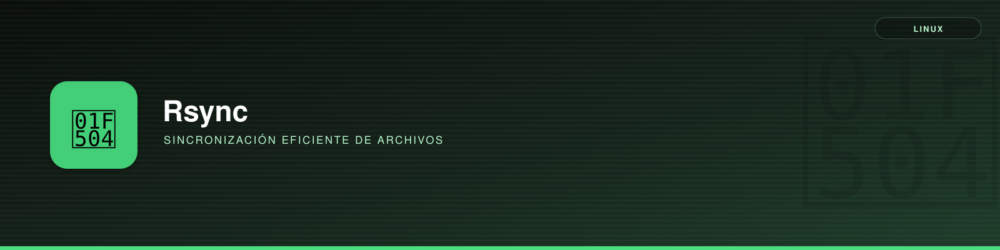

# Guía de Rsync



**Descripción**:  
`rsync` es una herramienta para sincronizar y transferir archivos de manera eficiente entre directorios locales o remotos. Se utiliza en copias de seguridad, sincronización de datos y migración de archivos, ofreciendo opciones avanzadas como compresión, eliminación de archivos no sincronizados y ejecución en modo prueba.

Algunas de sus ventajas son:
- 🔹 **No requiere abrir puertos adicionales** cuando se usa con `ssh`, lo que lo hace más seguro.
- 🔹 **Consume menos recursos** que herramientas como Nextcloud o Syncthing.
- 🔹 **Ideal para sincronización programada**, en lugar de una sincronización en tiempo real.

---

## Instalación

### Requisitos previos
- 📌 **Sistema operativo**: Linux, macOS (preinstalado) y Windows (mediante WSL o Cygwin).  
- 📌 **Dependencias**: `rsync` instalado en el sistema de origen y destino.  
- 📌 **Acceso**: Permisos adecuados para leer/escribir en las rutas de origen y destino.  

### Instalación en Linux

```bash
# Debian / Ubuntu
sudo apt update && sudo apt install rsync -y

# RHEL / CentOS / Fedora
sudo dnf install rsync -y

# Arch Linux
sudo pacman -S rsync
```

---

## Uso de Rsync

### Sintaxis básica
```bash
rsync [opciones] <origen> <destino>
```
Ejemplo de copia local:
```bash
rsync -av /home/user/docs/ /mnt/backup/
```
Ejemplo de transferencia remota:
```bash
rsync -av /home/user/docs/ usuario@servidor:/backup/
```

### Opciones comunes
| Opción | Descripción |
|--------|------------|
| `-a` | Modo archivo: copia recursiva manteniendo permisos, timestamps, etc. |
| `-v` | Modo verbose: muestra detalles de la transferencia. |
| `-h` | Formatea los tamaños en un formato legible (KB, MB, GB). |
| `--progress` | Muestra el progreso de cada archivo. |
| `--delete` | Elimina archivos en el destino que no están en el origen. |
| `--dry-run` | Simula la operación sin hacer cambios. |
| `--checksum` | Verifica archivos mediante un hash en lugar de fecha/tamaño. |

---

## Configuración Básica

### Sincronizar contenido entre carpetas
⚠️ **Precaución**: Un error en la ruta puede borrar archivos importantes.  

```bash
rsync -av --delete </ruta/de/ORIGEN/> </ruta/de/DESTINO/>
```
✅ **Explicación**:  
- `-a` → Copia con preservación de atributos.  
- `-v` → Muestra detalles de los archivos copiados.  
- `--delete` → Borra del **destino** los archivos que no están en el **origen**.  

### Modo prueba (`--dry-run`)
Simula la operación sin modificar archivos. Para asegurarte de que `rsync` hará lo correcto antes de ejecutar:

```bash
rsync -av --delete --dry-run /media/carmelo/lib_33/ /media/carmelo/bkl_33/
```


OJO con el destino y el origen, que como lo hagas mal, lo borras todo:  

- Usar el flag '--dry-run'   :   para hacerlo en modo de 'prueba'
- Usar el flat '--delete'    :   para eliminar <destino> los ficheros que NO se encuentren en <origen>
- Usar el flat '--remove-source-files'   :   para eliminar los archivos en el origen después de copiarlos.
- Usar el flat '--remove-source-dirs'    :   para eliminar los dirs en el origen después de copiarlos.

```bash
$       rsync -av   --delete                                         </ruta/de/ORIGEN/>      usuario@direccion_ip_servidor:</ruta/de/DESTINO/>
$ time  rsync -avih --stats     --progress --log-file=<path_log>     <origen/>               <destino/>
$ time  rsync -avih --stats --delete --dry-run --progress /media/carmelo/lib_33/ /media/carmelo/bkl_33/

$ time rsync -avih --stats --delete --dry-run --progress -e ssh "mediauser@192.168.1.100:'/mnt/media/peliculas/TRON\ *.mkv'" /home/tuusuario/peliculas/

$ time rsync -avih --stats --delete --dry-run --progress -e ssh --include='TRON *.mkv' --exclude='*' carmelo@192.168.1.130:/media/carmelo/bkl_01/peliculas/mkv/ /mnt/server/Movies/

```


---

## Configuración Avanzada

### Transferir y eliminar archivos en el origen  
Para mover archivos en lugar de copiarlos:

```bash
rsync -av --remove-source-files /origen/ /destino/
```
✅ Elimina los archivos en **origen** después de copiarlos.  

Para eliminar también los **directorios vacíos** en el origen:

```bash
rsync -av --remove-source-files --remove-source-dirs /origen/ /destino/
```

### Guardar logs y estadísticas de la transferencia
```bash
rsync -avih --stats --progress --log-file=/var/log/rsync.log /origen/ /destino/
```
✅ Registra la operación en `/var/log/rsync.log`.  

---

## Solución de Problemas

**Error: "rsync: command not found"**  
🔹 Solución: Asegúrate de que `rsync` está instalado (`rsync --version`).  

**Error: "Permission denied"**  
🔹 Solución: Usa `sudo` o verifica permisos (`ls -l`).  

**Error: "rsync: failed to set times on ‘file’"**  
🔹 Solución: Prueba con `--no-t` si el sistema de archivos no admite timestamps.  

---
