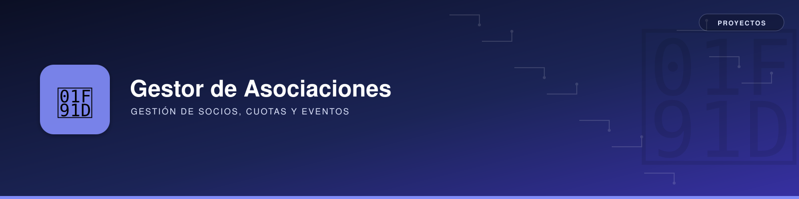

# 🚀 Gestor de Asociaciones



---

## 📖 Descripción General  
Este proyecto proporciona una herramienta de software diseñada para cubrir las necesidades básicas de gestión en pequeñas asociaciones.  
Permite llevar un control sencillo pero eficaz de socios, cuotas y eventos, facilitando el día a día de asociaciones que no requieren soluciones complejas ni infraestructura en la nube.

Es una **aplicación auto instalable** desarrollada en **Python**, que requiere una **licencia válida** para su activación y uso.

---

## 🎯 Objetivos  
- Facilitar el registro y gestión de socios de forma simple.  
- Automatizar la contabilidad básica de cuotas y pagos.  
- Permitir el seguimiento y documentación de eventos como viajes, reuniones y actividades.  
- Ofrecer una solución local, sin necesidad de conexión a internet o registro en plataformas externas.  

---

## 🛠 **Tecnologías Utilizadas**  
- **Backend:** Python  
- **Frontend:** HTML/CSS con interfaz local (Tkinter o similar)  
- **Base de datos:** SQLite (almacenamiento local)  
- **Infraestructura:** Aplicación local ejecutable en escritorio (Windows/Linux)  

---

## 📦 **Repositorio del Código**  
[Enlace al repositorio en GitHub](https://github.com/usuario/repositorio)  

---

## 🏛️ **Arquitectura del Sistema**  
```mermaid
%% Aquí puedes añadir un diagrama Mermaid si ya lo tienes definido, o dejarlo en blanco para añadirlo después.
```

---

## 📊 **Diagramas del Sistema**  
- [Diagrama de Clases](diagramas/diagrama_clases.md)
- [Diagrama Entidad-Relación](diagramas/diagrama_er.md)

---

## 👥 **Actores del Sistema**
- [Actores](actores.md)

---

## 🗂️ **Secciones**
- [Secciones de la Aplicación](secciones.md)

---

## 📚 **Épicas**  
- [EP-0001 - Instalación de la Aplicación](epic/EP-0001-instalacion.md)  
- [EP-0002 - Primera Ejecución del Programa](epic/EP-0002-primera-ejecucion.md)  


