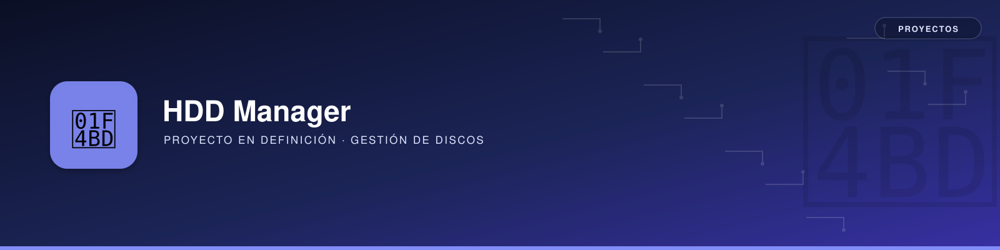

# 🚀 HDD Manager



!!! note "Proyecto en definición"
    Esta página aún no tiene alcance ni requisitos cerrados. El contenido que sigue es una propuesta de partida a partir del nombre del proyecto, pendiente de validar.

## 📖 Descripción General
📌 **Resumen:**
Herramienta pensada para facilitar la gestión de discos duros externos (identificación, formateo, montaje automático y diagnóstico), en línea con las guías ya existentes en [Raspberry Pi → Añadir un Disco Duro Externo](../../raspberrypi/utilidades/pi-hdd/pi-hdd.md) y [Diagnóstico HDD y USB](../../raspberrypi/utilidades/pi-hdd/diagnostico-usb.md).

## 🎯 Objetivos (propuesta)
- ✅ Detectar e identificar discos conectados por USB.
- ✅ Automatizar el formateo seguro y el montaje por UUID.
- ✅ Diagnosticar problemas de alimentación/montaje habituales en discos USB.

## 📚 Épicas
Aún no se han definido épicas para este proyecto.

## 🏛️ **Arquitectura del Sistema**
```mermaid

```

## 🛠 **Tecnologías Utilizadas**
- 🖥 **Backend:** [Tecnología Backend]
- 🎨 **Frontend:** [Tecnología Frontend]
- 🗄 **Base de datos:** [Base de Datos]
- ☁️ **Infraestructura:** [Infraestructura]

## 📌 **Repositorio del Código**
🔗 [Enlace al repositorio en GitHub/GitLab](https://github.com/usuario/repositorio)
