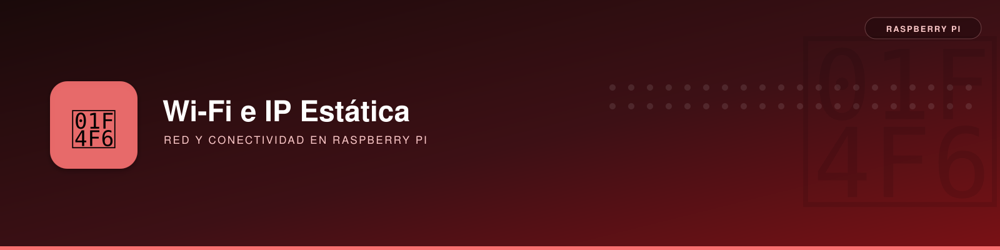

# Red Wi-Fi e IP estática en Raspberry Pi



**Descripción**: activar Wi-Fi con NetworkManager, configurar una IP fija y evitar perder el acceso SSH en Raspberry Pi OS / Debian moderno.

---

## Red inalámbrica

La interfaz `wlan0` apareció inicialmente como `unavailable`. El motivo real era Wi-Fi desactivado por software:

```bash
nmcli device status
nmcli radio all
# WIFI-HW enabled / WIFI disabled
sudo nmcli radio wifi on
nmcli device wifi list ifname wlan0
```

La red del laboratorio estaba anunciada en 2,4 y 5 GHz con el mismo SSID. Se omite su nombre real en el ejemplo para que la documentación pueda compartirse sin revelar identificadores de red.

```bash
sudo nmcli --ask device wifi connect 'NOMBRE_WIFI' ifname wlan0
nmcli -f GENERAL.CONNECTION,GENERAL.HWADDR,IP4.ADDRESS,IP4.GATEWAY,IP4.DNS device show wlan0
```

IP obtenida originalmente por DHCP: `192.168.1.147/24`; puerta de enlace `192.168.1.1`. En otro sistema, identificar siempre el nombre de la conexión y el rango real antes de modificarlo.

### Configuración estática en la Raspberry

El rango DHCP comprobado en el router era `192.168.1.100–192.168.1.254`. Se eligió `192.168.1.20`, fuera de ese rango, tras una comprobación ARP sin respuestas:

```bash
# Desde Mint: sondeo orientativo, no prueba absoluta de ausencia de conflicto
sudo arp-scan --interface=wlo1 192.168.1.20
```

Desde la Raspberry (preferentemente con consola local o SSH sobre Ethernet para no perder el acceso). Sustituir `NOMBRE_WIFI`, direcciones, DNS y puerta de enlace por los valores correctos:

```bash
# Descubrir el nombre exacto del perfil antes de modificarlo
nmcli -g GENERAL.CONNECTION device show wlan0
nmcli connection show
```

!!! warning "No perder la sesión SSH"
    `nmcli connection up` puede cortar la propia conexión desde la que se configura. Verificar que la IP elegida no entra en conflicto y disponer de Ethernet, consola o acceso físico. Considerar reserva DHCP en el router como alternativa.


```bash
sudo nmcli connection modify 'NOMBRE_WIFI' \
  ipv4.method manual \
  ipv4.addresses '192.168.1.20/24' \
  ipv4.gateway '192.168.1.1' \
  ipv4.dns '212.230.135.2 212.230.135.1'

sudo nmcli connection up 'NOMBRE_WIFI' ifname wlan0
ip -4 addr show wlan0
```

La salida mostró `inet 192.168.1.20/24` con `valid_lft forever`, y se verificó SSH desde Mint:

```bash
ssh pi@192.168.1.20
```

!!! caution "Dirección reservada"
    Estar fuera del rango DHCP no impide conflictos con otra IP configurada manualmente. Comprobar también la tabla de clientes/reservas del router. Si el router lo permite, una reserva DHCP por MAC evita modificaciones en la configuración del cliente.

---

## Diagnóstico si cambia la red o se pierde la IP

```bash
nmcli radio all
nmcli device status
nmcli -f IP4.ADDRESS,IP4.GATEWAY,IP4.DNS device show wlan0
ip -4 route
sudo journalctl -u NetworkManager -b --no-pager | tail -n 60
```

- Si `wlan0` figura como `unavailable`, comprobar el radio Wi-Fi antes de reinstalar controladores.
- Si el SSID se anuncia en dos bandas, comprobar cobertura, país/región y estabilidad del enlace.
- Si la IP elegida estaba fuera del rango DHCP, eso **no garantiza** ausencia de conflicto con otro equipo configurado manualmente.
- Ante una pérdida de conexión después del cambio, recuperar primero la Raspberry por Ethernet o consola y revisar el perfil con `nmcli connection show`.

---

## Consideraciones de compatibilidad

!!! important "NetworkManager frente a dhcpcd"
    En Debian 13 / Raspberry Pi OS moderno, este equipo utiliza **NetworkManager**. Los ejemplos antiguos de `dhcpcd.conf` o `systemd-networkd` de la [guía de instalación básica](../../instalacion-basica/instalacion-basica.md) no deben aplicarse simultáneamente a una interfaz controlada por NetworkManager.

Para recuperar una cuenta o el acceso inicial: [primer acceso y recuperación SSH](../ssh/acceso-recuperacion.md).

## Referencias

- [NetworkManager y nmcli](https://networkmanager.dev/docs/api/latest/nmcli.html).
- [Configuración de red Raspberry Pi](https://www.raspberrypi.com/documentation/computers/configuration.html).
