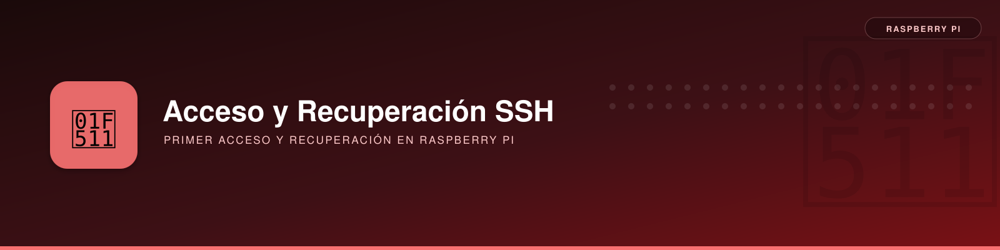

# Primer acceso y recuperación de SSH en Raspberry Pi



**Descripción**: instalación *headless* (sin monitor ni teclado), localización de la IP, conexión por Ethernet directa desde Linux Mint y recuperación del usuario inicial cuando SSH rechaza conexiones.

---

## Requisitos previos

- Raspberry Pi OS / Debian ARM64 grabado en microSD con Raspberry Pi Imager.
- SSH y Wi-Fi preconfigurados durante el flasheo, si se dispone de las credenciales.
- Linux Mint con cliente OpenSSH, `arp-scan` y `nmap`.
- Cable Ethernet para recuperación si falla el Wi-Fi.

## Instalación e identificación inicial

### Buscar el equipo en la red inalámbrica

```bash
# Desde Linux Mint
ping raspberrypi.local
sudo arp-scan --interface=wlo1 --localnet
sudo nmap -n -sS -p 22 --open 192.168.1.0/24
```

`raspberrypi.local` solo funciona si el nombre es correcto, el Raspberry anuncia mDNS y no existe aislamiento entre clientes. La ausencia de resolución **no demuestra** que el equipo esté apagado. El escaneo inicial no localizó SSH en los otros clientes de la Wi-Fi.

### Recuperación por Ethernet directo al NUC

En las pruebas, Linux Mint tenía la interfaz `enp86s0` con `192.168.50.1/24`. Inicialmente su perfil era `ipv4.method manual`, por lo que **no ofrecía necesariamente DHCP** al dispositivo conectado.

```bash
# En Mint: configurar conexión compartida, con DHCP/NAT mediante NetworkManager
sudo nmcli connection modify 'Conexión cableada 1' \
  ipv4.method shared ipv4.addresses 192.168.50.1/24
sudo nmcli connection down 'Conexión cableada 1'
sudo nmcli connection up 'Conexión cableada 1'

# Buscar la Raspberry por el cable
sudo arp-scan --interface=enp86s0 --localnet
```

En esta instalación se detectó `192.168.50.66` (MAC Ethernet `E4:5F:01:6C:DC:27`). En un arranque diferente la IP DHCP puede cambiar.

```bash
ip -br link show enp86s0  # LOWER_UP implica enlace físico
ssh pi@192.168.50.66
```

### Interpretar los errores

| Mensaje | Significado | Qué hacer |
|---|---|---|
| `Nombre o servicio desconocido` | mDNS o nombre no resuelto | Buscar IP por ARP o router |
| `Connection refused` | Puerto SSH rechazado (antes de autenticar) | Habilitar servidor SSH; no probar contraseñas al azar |
| `Permission denied` | SSH responde, pero las credenciales fallan | Revisar usuario/contraseña o claves |
| `The authenticity of host...` | Primera conexión a una IP/clave nueva | Verificar huella antes de aceptar |

---

## Recuperar el usuario inicial desde la microSD

En esta Raspberry el usuario `pi` existía, pero tenía inicialmente una shell de bloqueo:

```text
pi:x:1000:1000::/home/pi:/usr/sbin/nologin
```

Se recuperó la tarjeta desde Linux Mint, montada como:

```text
/dev/sdb1  vfat  bootfs  /media/carmelo/bootfs
/dev/sdb2  ext4  rootfs  /media/carmelo/rootfs
```

!!! warning "No asumir la ruta de la tarjeta"
    Antes de operar, ejecutar `lsblk -o NAME,SIZE,FSTYPE,LABEL,MOUNTPOINTS`. No ejecutar comandos contra `/dev/sdb` sin comprobar que corresponde realmente a la microSD.

```bash
# En Mint, con las particiones de la microSD montadas
ls /media/$USER/rootfs/home
grep '^pi:' /media/$USER/rootfs/etc/passwd
```

### Configurar un usuario inicial y SSH

En la instalación documentada funcionó crear el archivo de configuración inicial `userconf.txt` en `bootfs`:

```bash
# Ejecutar desde Mint. La contraseña no se muestra en pantalla.
read -rsp 'Nueva contraseña para pi: ' CLAVE
echo
printf 'pi:%s\n' "$(printf '%s\n' "$CLAVE" | openssl passwd -6 -stdin)" \
  | sudo tee /media/$USER/bootfs/userconf.txt >/dev/null
unset CLAVE

# Habilitar SSH al iniciar Raspberry Pi OS
sudo touch /media/$USER/bootfs/ssh
sync
sudo umount /media/$USER/rootfs
sudo umount /media/$USER/bootfs
```

**Resultado real:** después del arranque se pudo conectar con `ssh pi@192.168.50.66` usando la nueva contraseña. La presencia de `/home/pi` por sí sola no garantiza que la cuenta esté inicializada.

!!! note "Versiones modernas"
    Raspberry Pi OS actual no debe asumirse con credenciales predeterminadas `pi`/`raspberry`. La creación de `userconf.txt` corresponde al mecanismo de **primer arranque**; para un sistema ya inicializado se usan herramientas de administración de cuentas o recuperación offline, según el caso.

---

## Acceso posterior mediante clave pública

Desde Linux Mint:

```bash
ls -l ~/.ssh/*.pub
ssh-copy-id -i ~/.ssh/id_rsa.pub pi@192.168.1.20
ssh pi@192.168.1.20
```

La clave RSA pública ya existente en el NUC se copió correctamente y el acceso posterior quedó **sin petición de contraseña SSH**. No almacenar claves privadas ni contraseñas en MkDocs.

## Guías relacionadas

- [Instalación básica de Raspberry Pi](../../instalacion-basica/instalacion-basica.md).
- [Guía general de SSH en Linux](../../../linux/redes/ssh/ssh.md).
- [Montar directorios remotos con SSHFS en Linux](../../../linux/sistemas-archivos/sshfs/sshfs.md).

## Referencias

- [Acceso remoto en Raspberry Pi](https://www.raspberrypi.com/documentation/computers/remote-access.html).
- [Configuración de Raspberry Pi OS](https://www.raspberrypi.com/documentation/computers/configuration.html).
