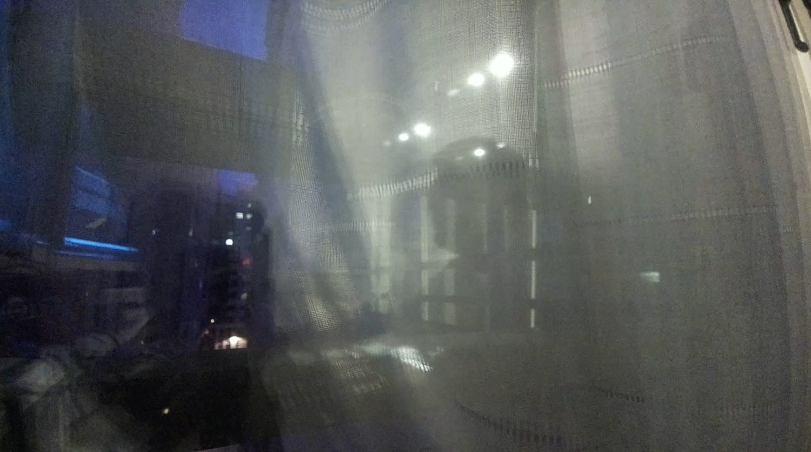
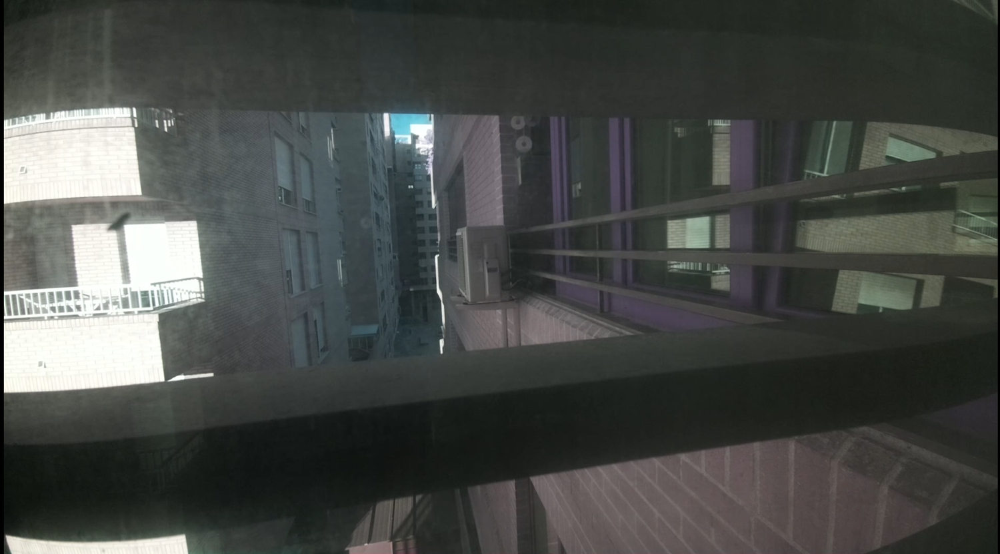
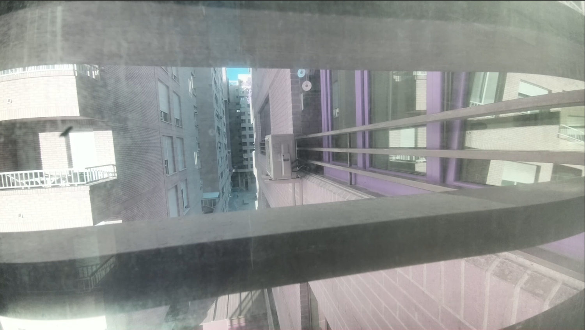
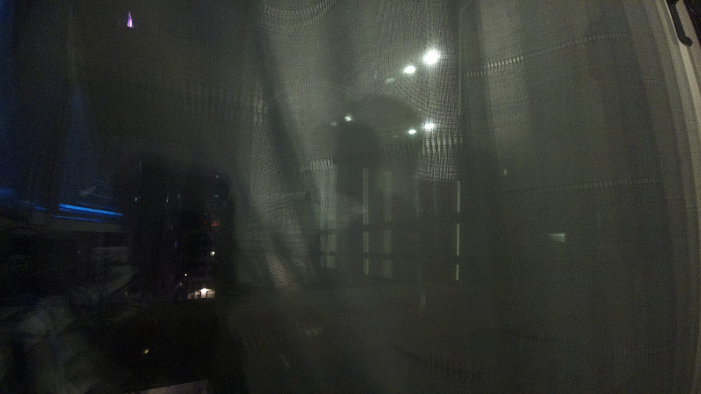
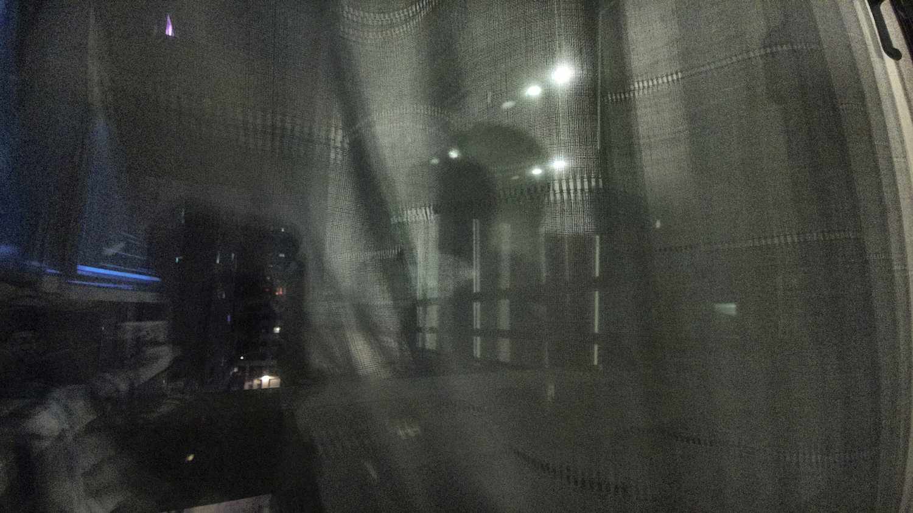
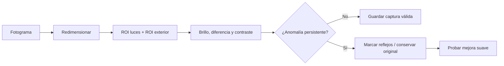

# Calibración de cámara NoIR y reflejos en doble acristalamiento



**Descripción**: explicación de las limitaciones físicas de una cámara NoIR enfocada al exterior a través de un doble cristal, ensayos reales de HDR y CLAHE, y propuesta ligera de detección/corrección con OpenCV.

---

## Problema óptico

La cámara está separada de una ventana con doble acristalamiento, con aproximadamente **10 cm de separación entre los cristales**. Al encender luces interiores, sus reflexiones se superponen a la escena exterior.

Los defectos visibles son:

- **Reflejos especulares** de luminarias (puntos luminosos y duplicaciones).
- **Velo luminoso** extendido, con disminución de contraste.
- **Cambios de color** asociados al sensor NoIR, que no incorpora filtro IR-cut.
- **Ruido nocturno** y reflejos en el propio vidrio o mosquitera/trama aparente de la imagen.

!!! warning "Límite de la corrección digital"
    En general, a partir de una sola imagen no se puede separar de forma inequívoca la luz reflejada de la luz transmitida. **Si el reflejo satura u oculta una zona, el detalle perdido no se puede recuperar fielmente** con CLAHE, balance de blancos, HDR o un modelo de IA convencional.

## Resultados visuales

### Día y HDR


*Imagen diurna con contraste problemático en las fachadas.*


*Ensayo con `--hdr auto`: mayor visibilidad general del callejón, con zonas claras aún lavadas.*

### Noche: reflejos interiores


*Las lámparas del interior y el velo gris son tan visibles como parte del exterior.*

### CLAHE sobre el canal de luminosidad

La prueba disponible partió de una imagen de 1920×1080 y aplicó CLAHE en LAB con `clipLimit=1.5` y mosaico 8×8.


*Original.*


*Resultado de CLAHE. Diferencia poco significativa en relación con los reflejos; no los elimina.*

**Conclusión comprobada**: CLAHE no resolvió el problema principal. Incluso puede potenciar texturas y ruido. No tiene sentido presentarlo como restauración de reflejos.

### Cómo repetir la comparación sin confundir resultados

1. Conservar siempre el JPEG original sin modificar.
2. Capturar dos fotografías con la misma cámara, encuadre y luces exteriores similares: una con el entorno interior iluminado y otra con luz interior reducida cuando sea posible.
3. No comparar únicamente dos variantes procesadas de una imagen ya velada.
4. Si los reflejos desaparecen al bloquear físicamente la luz interior, priorizar esa solución; ajustar contraste después.

**Prueba pendiente:** todavía no se ha registrado una nueva fotografía con un túnel opaco hasta el primer cristal. La mejora es plausible por óptica, pero **no se ha verificado en este montaje**.

---

## Ajustes recomendados antes del procesamiento

| Acción | Resultado esperado | Límite |
|---|---|---|
| Oscurecer la habitación | Reduce energía reflejada en ambas láminas | No siempre posible |
| Túnel opaco entre cámara y primer vidrio | Bloquea buena parte de la luz lateral interior | En el gran angular podría invadir el encuadre |
| Reubicar la cámara o variar el ángulo | Desplaza reflejos fuera del campo visual | Puede perderse el encuadre deseado |
| Limpiar vidrio y objetivo | Reduce dispersión | No quita reflejos geométricos |
| Polarizador lineal/circular | Puede atenuar determinados reflejos | Reduce exposición y no funciona igual con todas las incidencias |
| Filtro IR-cut | Mejora fidelidad del color durante el día | Reduce utilidad nocturna de una NoIR |

Una solución física no requiere tocar necesariamente el segundo cristal: si se impide que la luz interior alcance el área vista por la cámara en el **primer cristal**, también disminuye la luz reflejada por interfaces posteriores. La efectividad depende de geometría y materiales.

---

## Detección con visión artificial ligera — propuesta no desplegada

En una Raspberry Pi 4 de 2 GiB evitar ejecutar inferencia pesada sobre vídeo continuo 1080p a 30 FPS. Un primer detector con OpenCV puede operar sobre previsualizaciones **320×180 o 640×360 cada 2–5 segundos**.

### Referencias requeridas

1. Capturar una referencia nocturna con luz interior **apagada**.
2. Capturar otra referencia con luz interior **encendida**, sin mover la cámara.
3. Para comparar numéricamente, mantener fijos (en lo posible) exposición, ganancia y balance de blancos. Con controles automáticos la comparación será menos fiable.
4. Definir regiones de interés (ROI) en áreas donde se reflejan las lámparas; excluir, si es posible, luces exteriores permanentes.

### Indicadores sugeridos

- Cambio medio de luminosidad de la ROI respecto a una referencia.
- Porcentaje de píxeles de alto brillo en la ROI.
- Variación del contraste local en una ROI de fachada exterior.
- Persistencia de la anomalía varios análisis consecutivos.



No se ha entrenado un clasificador ni se dispone aún de umbrales estadísticos. No asignar porcentajes de confianza hasta realizar una validación con datos etiquetados.

## Corrección experimental — alcance realista

Se puede probar sobre imágenes **no saturadas**:

- Balance de blancos por ganancias conocidas; no usar *gray-world* indiscriminadamente con una escena dominada por paredes grises o IR.
- Contraste local moderado en el canal de luminancia (CLAHE).
- Atenuación de halos de baja frecuencia mediante una estimación espacial del velo; puede producir artefactos y debe conservarse el original.
- Reducción de ruido nocturno para JPEG de calidad suficiente.

Las capturas se clasificarían como **normal**, **corregible** o **muy afectada**, guardando métricas en un CSV/JSON junto a los originales. No borrar automáticamente originales durante la fase de calibración.

### Código usado en la primera prueba CLAHE

```python
import cv2

imagen = cv2.imread('original.jpg')
if imagen is None:
    raise RuntimeError('No se pudo abrir original.jpg')

lab = cv2.cvtColor(imagen, cv2.COLOR_BGR2LAB)
l, a, b = cv2.split(lab)
l = cv2.createCLAHE(clipLimit=1.5, tileGridSize=(8, 8)).apply(l)
resultado = cv2.cvtColor(cv2.merge((l, a, b)), cv2.COLOR_LAB2BGR)
cv2.imwrite('corregida.jpg', resultado, [cv2.IMWRITE_JPEG_QUALITY, 95])
```

Resultado real: **sin mejora sustancial** en el reflejo. Una futura integración con Picamera2 debe controlar la cámara desde **un único proceso** para evitar conflictos con `rpicam-vid`.

## Guías relacionadas

- [Cámara IMX708: captura, vídeo y perfiles](camara-video.md).
- [Timelapse](timelapse.md).

## Referencias

- [Documentación Raspberry Pi Camera](https://www.raspberrypi.com/documentation/computers/camera_software.html).
- [OpenCV: mejora de contraste local (CLAHE)](https://docs.opencv.org/4.x/d5/daf/tutorial_py_histogram_equalization.html).
