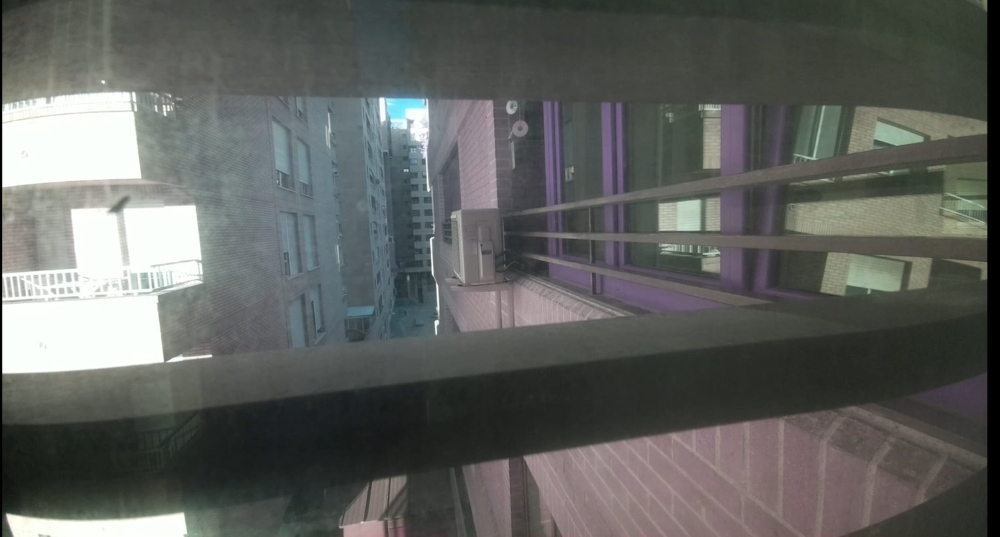
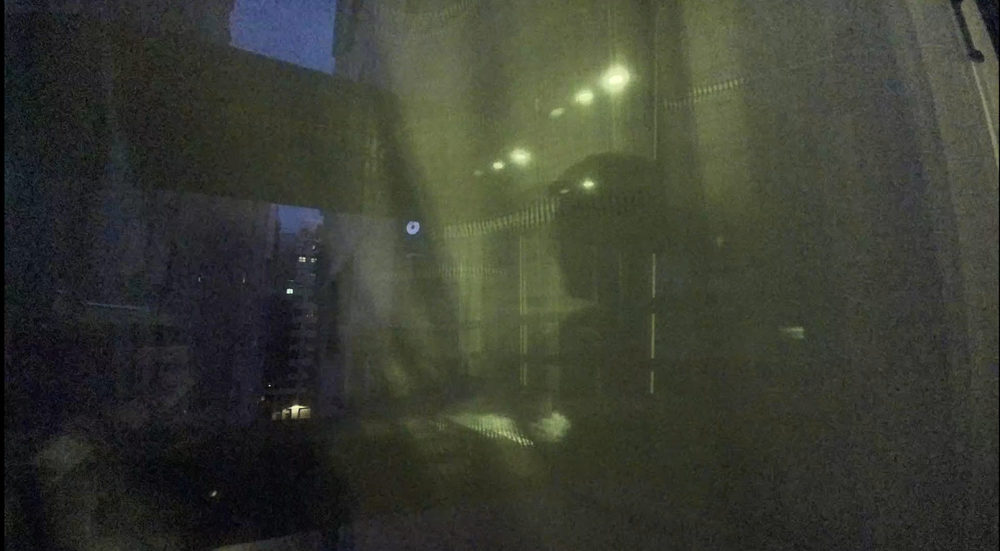

# Cámara IMX708 NoIR y vídeo en directo desde Linux Mint


**Descripción**: identificar la Camera Module 3 Wide NoIR, tomar fotografías, transmitir H.264 por TCP a Linux Mint y ensayar perfiles de imagen de día y noche.

---

## Equipo de referencia

- Raspberry Pi 4 Model B Rev. 1.4, **2 GiB**, Debian 13 ARM64.
- Camera Module 3 Wide NoIR (sensor Sony IMX708), 4608×2592.
- Visualización desde un NUC con Linux Mint mediante `ffplay`.
- Red local: Raspberry `192.168.1.20`, servidor de vídeo TCP 8888.

Los comandos de esta página documentan pruebas verificadas en octubre de 2026. Para configurar un equipo desde cero consultar la [instalación básica](../instalacion-basica/instalacion-basica.md), la [red Wi-Fi](../acceso-conectividad/red/wifi-ip-estatica.md) y la [recuperación de SSH](../acceso-conectividad/ssh/acceso-recuperacion.md).

## Detectar el sensor y modos de captura

```bash
rpicam-hello --list-cameras
```

Salida observada (resumida):

```text
0 : imx708_wide_noir [4608x2592 10-bit RGGB]
1536x864   ~120.13 fps (modo de sensor)
2304x1296   ~56.03 fps (modo de sensor)
4608x2592   ~14.35 fps (modo de sensor)
```

Estas cifras son máximos indicativos del **modo de lectura del sensor**, no velocidades garantizadas de vídeo codificado con cualquier configuración.

### Captura JPEG

```bash
rpicam-still --nopreview --timeout 3000 \
  --width 4608 --height 2592 --quality 95 \
  --output /home/pi/foto-prueba.jpg
```

Para copiarla directamente desde Mint:

```bash
ssh pi@192.168.1.20 \
  'rpicam-still --nopreview -o /tmp/prueba-camara.jpg'
scp pi@192.168.1.20:/tmp/prueba-camara.jpg ~/prueba-camara.jpg
xdg-open ~/prueba-camara.jpg
```

---

## Vídeo en directo: método validado

El envío del H.264 a través de una tubería `ssh ... | ffplay ...` produjo errores al leer el encabezado del vídeo (`unspecified size`). La grabación en archivo H.264 sí funcionó. Se resolvió utilizando **TCP directo** entre la Pi y Linux Mint.

### En la Raspberry (servidor)

```bash
rpicam-vid -t 0 -n \
  --codec h264 --inline --listen \
  --width 1920 --height 1080 --framerate 30 \
  -o tcp://0.0.0.0:8888
```

### En Linux Mint (cliente)

```bash
ffplay -f h264 \
  -fflags nobuffer -flags low_delay -framedrop \
  -i tcp://192.168.1.20:8888
```

Este método fue **verificado visualmente**. Finalizar con `Ctrl+C` en la terminal del servidor. En la LAN, el puerto `8888/TCP` transporta vídeo **sin cifrar**; no abrirlo directamente a Internet.

!!! note "Solo una aplicación puede tener la cámara"
    Si `rpicam-vid` sigue activo, `rpicam-still` puede fallar con `failed to acquire camera` / `Device or resource busy`. Detener el proceso anterior antes de tomar otra captura independiente.

---

## Perfiles probados

### Día: HDR, compensación negativa y balance de blancos diurno

```bash
rpicam-vid -t 0 -n \
  --codec h264 --inline --listen \
  --width 1920 --height 1080 --framerate 30 \
  --hdr auto --awb daylight --ev -1.0 \
  --saturation 0.85 --contrast 1.0 --sharpness 1.0 \
  --autofocus-mode continuous \
  -o tcp://0.0.0.0:8888
```

La captura HDR recuperó visibilidad de sombras en la escena de la ventana, pero también modificó la apariencia global del brillo. Estos valores **no son una calibración colorimétrica**.


*Primera referencia diurna.*


*Exposición y saturación ajustadas.*


*HDR activado: mejora visible de zonas oscuras; algunas altas luces siguen sin detalle.*

### Noche: exposición automática y menor cadencia

```bash
rpicam-vid -t 0 -n \
  --codec h264 --inline --listen \
  --width 1920 --height 1080 --framerate 15 \
  --awb auto --ev 0 \
  --saturation 0.85 --contrast 1.1 --sharpness 1.0 \
  --autofocus-mode continuous \
  -o tcp://0.0.0.0:8888
```

Al usar menos FPS queda más margen para exposiciones largas, pero pueden aumentar la borrosidad de movimiento y el ruido. El modelo NoIR mantiene dominantes de color bajo distintas fuentes luminosas.


*Los parámetros diurnos producen una escena nocturna oscura y con dominante.*


*Al mejorar la exposición también resultan más visibles los reflejos de la iluminación interior.*

---

## Comprobar grabación H.264 y reproducirla

```bash
# En Mint, guardar cinco segundos para aislar fallos de streaming
ssh -T pi@192.168.1.20 \
  'rpicam-vid -t 5000 -n --codec h264 --inline --width 1280 --height 720 --framerate 30 -o -' \
  > ~/prueba-video.h264

ffprobe -v error -show_entries stream=codec_name,width,height \
  -of default=noprint_wrappers=1 ~/prueba-video.h264
ffplay -autoexit -f h264 ~/prueba-video.h264
```

Se obtuvo un archivo H.264 de aproximadamente 1,4 MiB a 1280×720 y pudo reproducirse correctamente.

## Diagnóstico del streaming y de la exclusividad del sensor

| Síntoma | Comprobar | Interpretación |
|---|---|---|
| `Device or resource busy` | `pgrep -af 'rpicam-(vid|still)'` | Un proceso previo tiene la cámara ocupada |
| `ffplay`: `unspecified size` al leer tubería SSH | Probar H.264 en archivo con `ffprobe` | En este caso el sensor **sí** generaba vídeo válido; el fallo estuvo en esa ruta de recepción |
| TCP no conecta a `:8888` | Ver si `rpicam-vid --listen` sigue ejecutándose | El servidor solo transmite mientras el proceso está activo |
| Vídeo muy oscuro con el perfil de día | Revisar `--awb`, `--ev`, FPS y HDR | Los parámetros diurnos no sirven automáticamente de noche |
| Texturas luminosas sobre el exterior | Comparar captura con luces interiores apagadas | Puede tratarse de reflejos en vidrio, no fallo de compresión |

!!! tip "Una sola aplicación controla el sensor"
    Para capturar fotos y vídeo de forma coordinada, usar un **único proceso** con Picamera2 u otra aplicación que administre la cámara. No intentar lanzar simultáneamente `rpicam-still` y `rpicam-vid` esperando que compartan el sensor.

---

## Resolución y H.265

- Las fotografías alcanzan **4608×2592**. La grabación H.264 debe respetar el rendimiento real de codificación.
- H.265/HEVC **no dispone de codificación por hardware equivalente a H.264 en Raspberry Pi 4**; codificar por software a alta resolución puede saturar sus 2 GiB de RAM y CPU.
- Se probó `--codec libav`, pero la versión instalada respondió `Unrecognised codec libav`; no usar ese valor sin verificar capacidades reales de la instalación.

## Siguientes pasos

- [Calibración de imágenes, HDR y reflejos nocturnos](calibracion-reflejos.md).
- [Timelapse y exportación MP4](timelapse.md).
- [Diagnóstico del sistema](../utilidades/sistema/mantenimiento-diagnostico.md).

## Referencias

- [Aplicaciones de cámara Raspberry Pi](https://www.raspberrypi.com/documentation/computers/camera_software.html).
