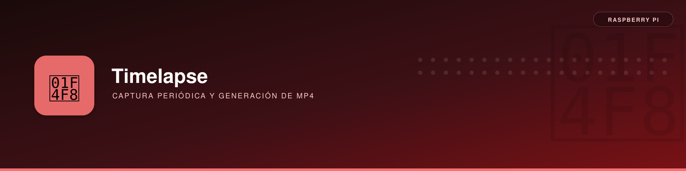

# Timelapse con cámara IMX708 y generación de MP4



**Descripción**: crear fotografías periódicas con `rpicam-still`, mantener la captura activa sin sesión SSH, detenerla y generar vídeo MP4 desde Linux Mint. Incluye una variante experimental con comprobación del HDD.

---

## Primera prueba realizada (microSD)

Se ejecutó un **script Python que lanzaba `rpicam-still` con `--timelapse 5000`**, durante un máximo de 7200 s (2 horas), con fotografías JPEG a 4608×2592.

```bash
nohup python3 -u ~/timelapse.py 7200 \
  > ~/timelapse.log 2>&1 < /dev/null & echo $! | tee ~/timelapse.pid

ps -p "$(cat ~/timelapse.pid)" -o pid,etime,stat,args
```

La sesión quedó en `~/timelapses/20261011_123103/`, con **676 fotografías**. Se detuvo voluntariamente:

```bash
pkill -TERM -x rpicam-still
```

El envoltorio Python terminó con un código de error al recibir `SIGTERM`. En este contexto era una **detención solicitada**, no una avería del sensor. Se eliminaron posteriormente las fotografías y el script de la microSD, porque ya se habían copiado al NUC.

### Copiar al NUC

```bash
# Desde Linux Mint
mkdir -p ~/timelapses
scp -r pi@192.168.1.20:/home/pi/timelapses/20261011_123103 ~/timelapses/
find ~/timelapses/20261011_123103 -name 'foto_*.jpg' | wc -l
```

### Convertir a MP4

```bash
ffmpeg -framerate 30 -pattern_type glob \
  -i "$HOME/timelapses/20261011_123103/foto_*.jpg" \
  -vf 'scale=1920:1080:flags=lanczos,format=yuv420p' \
  -c:v libx264 -preset medium -crf 18 -movflags +faststart \
  "$HOME/timelapses/20261011_123103/timelapse.mp4"

ffplay "$HOME/timelapses/20261011_123103/timelapse.mp4"
```

**Resultado verificado:** MP4 reproducible a 1080p y 30 FPS. Con 676 imágenes, duración teórica **22,53 segundos**. Las fotografías siguen disponibles en el NUC.

---

## Guardar futuros timelapses en el HDD

En esta instalación las rutas previstas son:

```text
/mnt/capturas/camara/timelapses/  # Secuencias de fotos
/mnt/capturas/camara/videos/      # MP4 finales
```

Primero conectar y montar el HDD:

```bash
findmnt /mnt/capturas
mountpoint -q /mnt/capturas || { echo 'HDD NO montado'; exit 1; }
```

### Script adicional: supervisión del montaje (sin validar en este equipo)

Se adjunta un script independiente, diseñado para **detener el proceso si desaparece el montaje**. No había sido ejecutado durante las pruebas; probar primero con 30–60 segundos y comprobar la salida.

**Descarga / copia:** [`scripts/timelapse_seguro.py`](scripts/timelapse_seguro.py)

Desde Linux Mint, con la raíz remota montada en `~/RaspberryPi/raiz`:

```bash
# Alternativa: copiar manualmente el archivo del paquete MkDocs al hogar pi
scp scripts/timelapse_seguro.py pi@192.168.1.20:/home/pi/timelapse_seguro.py
```

La orden `scp` anterior se ejecuta **desde la carpeta de documentación** que contiene `scripts/` (ajustar su ruta si es necesario).

```bash
# En la Raspberry: ensayo de 30 segundos (aprox. 6 JPEG)
python3 ~/timelapse_seguro.py 30

# Solo después, ejecución de dos horas
nohup python3 -u ~/timelapse_seguro.py 7200 \
  > ~/timelapse_seguro.log 2>&1 < /dev/null &
```

El script guardará en `/mnt/capturas/camara/timelapses/FECHA_HORA` y solo permitirá comenzar con el UUID esperado montado. Si se produce una desconexión con errores de E/S, los últimos archivos pueden quedar incompletos: **la comprobación periódica reduce el riesgo, pero no ofrece garantía absoluta de integridad**.

### Elegir cadencia y tamaño

| Intervalo | Capturas/hora | Capturas en 2 h | Duración a 30 FPS |
|---|---:|---:|---:|
| 5 segundos | 720 | 1440 | 48 s |
| 10 segundos | 360 | 720 | 24 s |
| 30 segundos | 120 | 240 | 8 s |

En el ensayo real el recuento fue de 676 porque se terminó la sesión antes de dos horas.

!!! note "Uso del sensor"
    No iniciar `rpicam-vid` y `rpicam-still` simultáneamente sobre la misma cámara. Si la prioridad es vídeo y captura concurrente se requerirá **un único proceso Picamera2** que entregue ambas salidas; esa arquitectura está pendiente de implementación.

## Guías relacionadas

- [Cámara y vídeo en directo](camara-video.md).
- [Montaje seguro y diagnóstico del HDD](../utilidades/pi-hdd/diagnostico-usb.md).
- [SSHFS desde Linux Mint](../../linux/sistemas-archivos/sshfs/sshfs.md).

## Referencias

- [Captura y timelapse en rpicam-apps](https://www.raspberrypi.com/documentation/computers/camera_software.html).
- [FFmpeg](https://ffmpeg.org/ffmpeg.html).
