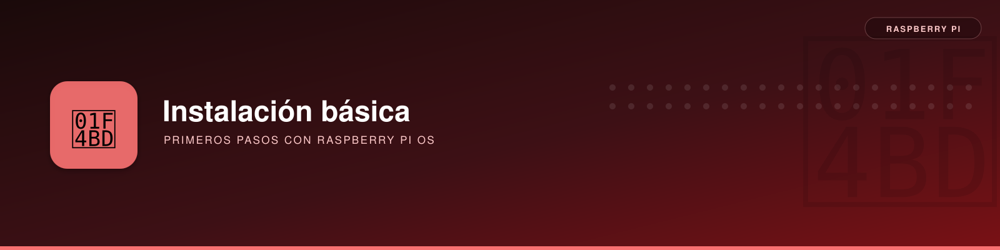

# Inicialización Básica de Raspberry Pi



**Descripción**:  
Guía de primeros pasos de una Raspberry Pi con Raspberry Pi OS Lite de 64 bits. Mantiene ejemplos históricos de red e incluye referencias verificadas de Debian 13 / ARM64, SSH, Docker y almacenamiento, para aplicar a cada instalación **solo el método que le corresponda**.

**Características principales**:  
- **Instalación de Raspbian Lite 64bit** - Configuración inicial y acceso remoto por SSH.  
- **Configuración de red estática** - Asignación de IP manual usando `dhcpcd` o `systemd-networkd`.  
- **Instalación de paquetes esenciales** - Herramientas básicas para administración del sistema.  

---

## Instalación

### Requisitos previos
- **Hardware**: Raspberry Pi (cualquier modelo soportado) y una tarjeta microSD.  
- **Software**: Raspberry Pi Imager, cliente SSH (PuTTY o terminal de Linux/macOS).  
- **Conexión a Internet**: Cable Ethernet o Wi-Fi configurado previamente.  

### Instalación de Raspbian Lite 64bit

1. **Descargar el instalador "Raspberry Pi Imager"**:  
    Visita la [página oficial de Raspberry Pi](https://www.raspberrypi.com/software/) y descarga `Raspberry Pi Imager`.

2. **Grabar la imagen en una tarjeta SD**:  
    Sigue los pasos en el siguiente `gif` para preconfigurar la imagen con acceso SSH.  
    ```bash
    anfitrión: naspicar.local
    usuario: naspicar
    ```
   

3. **Primer arranque y conexión por SSH**:  
    Descubrir la IP de la Raspberry Pi:  
    ```bash
    $ ping naspicar.local
    ```  
      
    Conectar por SSH:  
    ```bash
    $ ssh naspicar@192.168.1.245
    ```

4. **Actualizar el sistema y paquetes esenciales**:
    ```bash
    sudo apt-get update
    sudo apt-get full-upgrade
    sudo apt-get install -y vim htop tree
    sudo apt-get autoremove
    ```
    `fastfetch` está disponible como alternativa a `neofetch` en instalaciones modernas. Revisar las operaciones de `autoremove` antes de confirmar. En el equipo documentado se instalaron también `fastfetch` y otras utilidades administrativas.

---

## Acceso y red en instalaciones modernas (Debian 13 / ARM64)

!!! warning "Diferencia respecto a la guía histórica"
    Los comandos `dhcpcd` y `systemd-networkd` que aparecen más abajo documentan escenarios anteriores. En la instalación Raspberry Pi OS / Debian 13 analizada se configuró la red con **NetworkManager**. No configurar varios gestores para `wlan0` simultáneamente.

- [Primer acceso y recuperación de SSH sin monitor](../utilidades/ssh/acceso-recuperacion.md).
- [Configurar Wi-Fi e IP fija con NetworkManager](../utilidades/red/wifi-ip-estatica.md).
- [Actualizar y diagnosticar Raspberry Pi](../utilidades/sistema/mantenimiento-diagnostico.md).
- [Instalar Docker y Compose en Debian ARM64](../utilidades/docker/docker.md).

---

## Configuración de red

### Asignar IP estática

**Primero identificar el gestor de red activo:**

```bash
nmcli device status
systemctl is-active NetworkManager
systemctl is-active systemd-networkd
systemctl is-active dhcpcd
ip route
```

!!! warning "No mezclar gestores de red"
    En Raspberry Pi OS / Debian moderno con **NetworkManager**, seguir la [guía de IP fija con `nmcli`](../utilidades/red/wifi-ip-estatica.md). Las alternativas siguientes se conservan para equipos que **realmente usan** `dhcpcd` o `systemd-networkd`; no habilitarlas encima de NetworkManager.

#### Opción histórica 1: `dhcpcd` (solo si gobierna la interfaz)

Editar `/etc/dhcpcd.conf`:

```ini
interface eth0
static ip_address=192.168.1.20/24
static routers=192.168.1.1
static domain_name_servers=192.168.1.10
```

#### Opción alternativa 2: `systemd-networkd` (solo si ya administra la interfaz)

Crear o revisar `/etc/systemd/network/10-eth0.network`:

```ini
[Match]
Name=eth0

[Network]
Address=192.168.1.10/24
Gateway=192.168.1.1
DNS=192.168.1.10
```

!!! caution "Cambios remotos de IP"
    Modificar una conexión que transporta la sesión SSH puede cortarla. Configurar desde una consola local o tener otra vía de recuperación y reservar la IP en el router cuando sea posible.

Verificar desde otra sesión antes de reiniciar:

```bash
ip -4 address
ip route
```

Los nombres de archivo y opciones de red pueden variar entre versiones y distribuciones.

---

## Configuración con `raspi-config`
```bash
$ sudo raspi-config
```
La numeración puede variar según versión. Como referencia histórica, las opciones eran:

```text
1 System Option
  └── S5 Boot / Auto Login → B2 Console Autologin
5 Localisation Options
  ├── L1 Locale       → es_ES.UTF-8 UTF-8
  ├── L2 Timezone     → Europe / Madrid
  ├── L3 Keyboard
  └── L4 WLAN Country → ES Spain
6 Advanced Options
  └── A1 Expand Filesystem
8 Update
```

---

## Instalación de mhddfs

[En esta sección, aprenderás a instalar y configurar mhddfs en tu Raspberry Pi.](../../linux/sistemas-archivos/mhddfs/mhddfs.md)

---

## Solución de problemas

**Error 1: No se puede conectar por SSH**  
Solución: Verifica que SSH está habilitado:
```bash
$ sudo systemctl status ssh
```
Si está deshabilitado, actívalo:
```bash
$ sudo systemctl enable ssh
$ sudo systemctl start ssh
```

**Error 2: Problema con la IP estática**  
Solución: Verifica la configuración con:
```bash
$ ip addr
$ ip route show
```

**Error 3: Problemas con el arranque de `systemd-networkd`**  
Solución: Asegúrate de que el servicio está habilitado:
```bash
$ sudo systemctl status systemd-networkd
```


## Lecciones de la instalación sin pantalla (Raspberry Pi 4, Debian 13)

| Síntoma | Qué se comprobó | Referencia |
|---|---|---|
| No responde `raspberrypi.local` | mDNS puede no resolver aunque el equipo esté encendido; localizar la IP mediante router o ARP | [SSH inicial](../utilidades/ssh/acceso-recuperacion.md) |
| `Connection refused` en puerto 22 | SSH no estaba habilitado/inicializado; crear `ssh` en la partición de arranque y comprobar usuario | [Recuperar SSH](../utilidades/ssh/acceso-recuperacion.md) |
| Usuario `pi` con shell `nologin` | Inicialización incompleta; se utilizó `userconf.txt` durante primer arranque | [Usuario inicial](../utilidades/ssh/acceso-recuperacion.md) |
| `wlan0 unavailable` | Wi-Fi desactivada por software aunque el hardware estuviera habilitado | [Wi-Fi con NetworkManager](../utilidades/red/wifi-ip-estatica.md) |
| `vcgencmd get_throttled=0x50005` | Subtensión y limitación de frecuencia | [HDD y alimentación](../utilidades/pi-hdd/diagnostico-usb.md) |

### Lista de comprobación posterior al primer arranque

```bash
cat /etc/os-release
uname -m
hostname -I
systemctl is-active ssh
vcgencmd get_throttled
lsblk -o NAME,SIZE,FSTYPE,MOUNTPOINTS
```

Las direcciones IP, nombres de interfaz y sistemas de archivos mostrados en la guía son **ejemplos**: deben ajustarse a cada Raspberry y su red.
