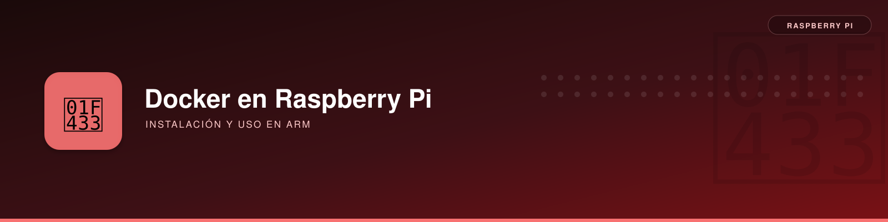

# Instalación de Docker y Docker Compose


**Descripción**:  
Docker y Docker Compose son herramientas esenciales para la creación y gestión de aplicaciones en contenedores. Su uso en Raspberry Pi permite maximizar la eficiencia del sistema, mejorando la portabilidad y escalabilidad de los proyectos.

Su capacidad para encapsular aplicaciones en contenedores hace que la gestión sea más eficiente, permitiendo una mayor escalabilidad y portabilidad en entornos de bajo consumo.

**Características principales**:  
✅ **Docker** - Encapsula aplicaciones y dependencias en contenedores ligeros y portátiles.  
✅ **Docker Compose** - Facilita la gestión de aplicaciones compuestas por múltiples contenedores mediante un archivo YAML.

📌 *Referencias*:  
- [Documentación oficial de Docker](https://docs.docker.com/)  
- [Guía de Docker Compose](https://docs.docker.com/compose/)

---

## Instalación

Antes de comenzar, asegúrate de cumplir con los siguientes requisitos previos:

### Requisitos previos
- 📌 **Sistema operativo compatible**: Raspberry Pi OS (basado en Debian) u otro sistema basado en Linux.
- 📌 **Dependencias**: `ca-certificates` y `curl` (disponibles en Debian actual).
- 📌 **Acceso**: Se requieren permisos de superusuario (*sudo*).

!!! warning "Instrucciones antiguas"
    No usar `apt-key`, repositorios `armhf` ni el antiguo paquete `docker-compose` de ejemplos para otras versiones. En Debian 13 ARM64 usar la instalación oficial con `docker.sources` y el plugin `docker compose`.

### Instalar Docker Engine y Docker Compose (Debian 13 ARM64)

#### Repositorio oficial para Debian ARM64

En este sistema se usó **`https://download.docker.com/linux/debian`**, suite **`trixie`**, arquitectura **`arm64`**. No mezclar con ejemplos antiguos de `armhf`, `raspbian` o `apt-key`.

```bash
sudo install -m 0755 -d /etc/apt/keyrings
sudo curl -fsSL https://download.docker.com/linux/debian/gpg \
  -o /etc/apt/keyrings/docker.asc
sudo chmod a+r /etc/apt/keyrings/docker.asc

sudo tee /etc/apt/sources.list.d/docker.sources >/dev/null <<'SOURCES'
Types: deb
URIs: https://download.docker.com/linux/debian
Suites: trixie
Components: stable
Architectures: arm64
Signed-By: /etc/apt/keyrings/docker.asc
SOURCES

sudo apt-get update
sudo apt-get install -y \
  docker-ce docker-ce-cli containerd.io docker-buildx-plugin docker-compose-plugin
```

#### Verificación

```bash
sudo systemctl is-enabled docker
sudo systemctl is-active docker
sudo docker version
docker compose version
sudo docker run --rm hello-world
```

Resultados reales:

- Servicio `docker`: **enabled / active**.
- Cliente y demonio: **Docker Engine 29.9.0**; `linux/arm64`.
- Compose: **v5.6.0**.
- Ejecución de contenedor `hello-world`: **correcta**.

#### Administrar Docker como usuario pi

```bash
sudo usermod -aG docker pi
newgrp docker
docker ps
```

!!! danger "Permisos equivalentes a root"
    El grupo `docker` concede capacidades administrativas equivalentes a `root`. Solo añadir usuarios de confianza. No publicar el socket de Docker en TCP sin controles de seguridad.

#### Mantenimiento opcional (pendiente de aplicar)

Para contener el crecimiento de los registros JSON en microSD puede usarse una configuración explícita del daemon, **solo tras comprobar compatibilidad con contenedores existentes**:

```json
{
  "log-driver": "local"
}
```

No se aplicó esta modificación durante las pruebas. Con 2 GiB RAM conviene fijar límites de memoria por contenedor según sus necesidades y supervisar `docker stats`.

### Otras versiones de Raspberry Pi OS

Los valores de `Suites` y `Architectures` del ejemplo corresponden a **Debian 13 (Trixie), ARM64**. En otros sistemas verificar `cat /etc/os-release` y `dpkg --print-architecture` y consultar la guía oficial apropiada antes de añadir un repositorio.

---

## Comprobaciones y errores encontrados en la Raspberry Pi 4

| Situación | Motivo habitual | Comando de diagnóstico / solución |
|---|---|---|
| `permission denied` al ejecutar `docker ps` | La sesión todavía no pertenece al grupo `docker` | `id -nG`; volver a iniciar sesión o `newgrp docker` |
| `docker-compose: command not found` | El plugin moderno usa otra sintaxis | `docker compose version` (**sin guion**) |
| Repositorio incorrecto | Ejemplos antiguos con `armhf` o `raspbian` | `cat /etc/os-release`; `dpkg --print-architecture` |
| Contenedor no arranca | Fallo en imagen, volúmenes o permisos | `docker ps -a`; `docker logs NOMBRE` |
| microSD sin espacio | Crecimiento de imágenes, volúmenes y registros | `docker system df`; `df -h /` |

```bash
# Diagnóstico cotidiano sin cambios destructivos
systemctl is-active docker
docker info --format '{{.ServerVersion}}'
docker compose version
docker system df
docker stats --no-stream
```

!!! warning "Limpieza de imágenes/volúmenes"
    No ejecutar `docker system prune -a --volumes` a ciegas: puede borrar recursos de aplicaciones apagadas o datos persistentes. Revisa qué contenedores y volúmenes necesitan conservarse.

En esta instalación real quedaron verificados Docker Engine **29.9.0** y Compose **v5.6.0** con `hello-world`. Las versiones se consignan como **resultado histórico**, no como requisito universal. El grupo `docker` equivale funcionalmente a privilegios administrativos.

---

## Ventajas y Desventajas

### Ventajas
- **Portabilidad**: Los contenedores Docker pueden ejecutarse en distintos entornos sin modificaciones.
- **Facilidad de uso**: Docker Compose permite definir y gestionar aplicaciones complejas con un solo archivo YAML.
- **Eficiencia**: Los contenedores consumen menos recursos que las máquinas virtuales.

### Inconvenientes
- **Recursos**: Aunque ligeros, los contenedores requieren CPU y RAM, lo que puede ser limitante en Raspberry Pi.
- **Curva de aprendizaje**: Requiere conocimiento previo sobre virtualización y despliegue de aplicaciones.

---

## Uso básico

Una vez instalado Docker y Docker Compose, puedes probar su funcionamiento con los siguientes comandos:

```bash
# Probar Docker
$ sudo docker run --rm hello-world

# Crear y ejecutar un contenedor simple
$ sudo docker run -d --name nginx-prueba -p 127.0.0.1:8080:80 nginx

# Listar los contenedores en ejecución
$ docker ps

# Detener y eliminar un contenedor
$ docker stop nginx-prueba
$ docker rm nginx-prueba
```

Para proyectos más complejos, puedes usar Docker Compose con un archivo `docker-compose.yml`:

```yaml
services:
  web:
    image: nginx
    ports:
      - "8080:80"
```

Ejecuta:

```bash
$ docker compose up -d
```


## Antes de levantar un proyecto Compose

1. Comprobar compatibilidad de la imagen con `linux/arm64` y disponer de espacio suficiente en microSD/HDD.
2. Guardar archivos persistentes en volúmenes o rutas cuyos permisos se hayan revisado.
3. No montar rutas del HDD externo si está ausente: en el caso documentado `/mnt/capturas` quedó **desmontado intencionadamente**.
4. Publicar puertos solo en las interfaces necesarias, especialmente cámaras, paneles y APIs que no incorporan autenticación.

Para el diagnóstico del almacenamiento USB: [guía general de HDD](../pi-hdd/pi-hdd.md) y [caso de sobrecorriente](../pi-hdd/diagnostico-usb.md).
