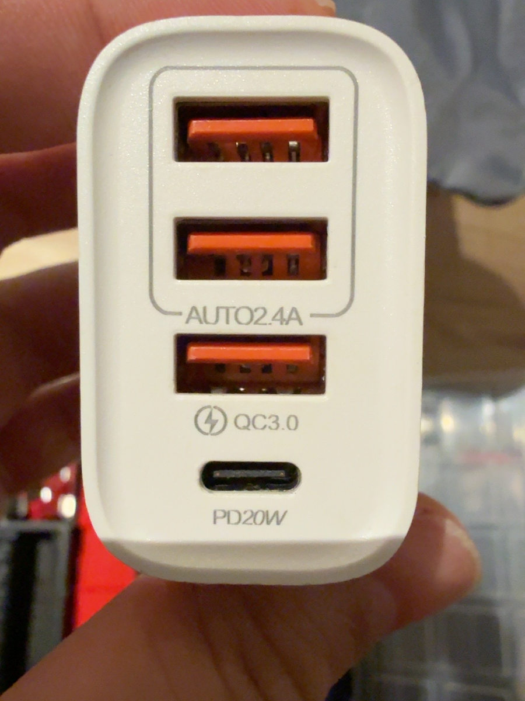
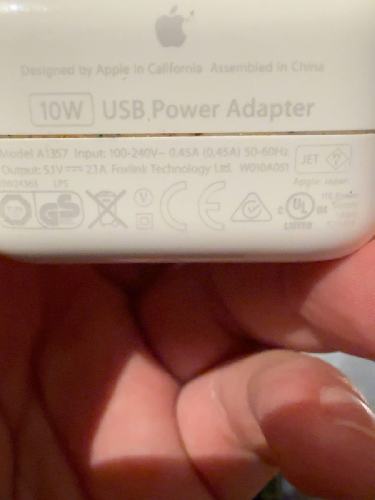

# HDD Toshiba de 1 TB: alimentación, montaje y seguridad


**Descripción**: diagnóstico de baja tensión y sobrecorriente USB, recuperación del HDD en USB 2.0, montaje `ext4` por UUID y medidas para evitar escribir capturas en la microSD cuando falte el disco.

---

## Hardware y pruebas de alimentación

Disco detectado:

```text
sda      931.5G TOSHIBA MQ01UBD100
└─sda1   931.5G ext4  LABEL=images
UUID=98967607-e566-4f45-b381-4960b27610e4
```

### Fuentes disponibles durante el diagnóstico


*Cargador AR-890: salidas indicadas en la etiqueta. El etiquetado comercial no prueba una tensión estable bajo carga.*


*Puertos USB-A y USB-C del AR-890.*


*Apple 10 W, rotulado 5,1 V / 2,1 A: insuficiente para garantizar la alimentación de una Raspberry Pi 4 con periféricos exigentes.*

La Raspberry Pi 4 necesita una fuente estable alrededor de **5,1 V / 3 A**. El diagnóstico inicial produjo:

```text
vcgencmd get_throttled
throttled=0x50005
```

Esto codifica **subtensión actual e histórica (bits 0 y 16)** y **limitación de frecuencia actual e histórica (bits 2 y 18)**. Al corregir la alimentación, se obtuvo `throttled=0x0` después de un nuevo arranque.

!!! important "El problema era eléctrico, pero no únicamente subtensión"
    `get_throttled=0x0` no descarta sobrecorriente **del bus USB**. Los registros mostraron `over-current change`, seguido de desconexiones USB y fallos de sincronización de caché.

### Diagnóstico del HDD en USB 3.0

```text
usb usb2-port1: over-current change #1
usb 2-2: USB disconnect, device number 2
sd 0:0:0:0: [sda] Synchronize Cache(10) failed
```

Inicialmente el dispositivo USB se enumeraba con tamaño `0B`; tras corregir la alimentación comenzó a mostrar 931,5 GiB. Conectado por USB 3.0 siguieron apareciendo desconexiones eléctricas.

### Cambio a USB 2.0

En el registro, a las 18:34 se desconectó el HDD SuperSpeed y se reconoció de nuevo como `new high-speed USB device` en `usb 1-1.4`, correspondiente a USB 2.0.

Se realizó una prueba de 512 MiB:

```bash
sudo dd if=/dev/urandom of=/mnt/capturas/prueba_usb.bin \
  bs=1M count=512 conv=fsync status=progress
sudo sha256sum /mnt/capturas/prueba_usb.bin
vcgencmd get_throttled
```

Resultados: media **30,7 MB/s**, archivo legible, hash calculable y `throttled=0x0`. **No aparecieron nuevas desconexiones después del cambio en el fragmento de registro analizado.** Esto valida una prueba breve, pero no sustituye un test prolongado ni descarta fallos futuros.

---

## Montaje temporal y permanente

### Identificar antes de operar

```bash
lsblk -o NAME,SIZE,MODEL,FSTYPE,LABEL,UUID,MOUNTPOINTS
```

!!! danger "No formatear"
    El HDD ya está en `ext4`. Durante las pruebas **no se formateó**. No ejecutar `mkfs` sin copia de seguridad y confirmación del dispositivo.

### Montar temporalmente

```bash
sudo mkdir -p /mnt/capturas
sudo mount -o noatime UUID=98967607-e566-4f45-b381-4960b27610e4 /mnt/capturas
findmnt /mnt/capturas
df -h /mnt/capturas
```

Resultados observados: `rw,noatime` y **916 GiB** de tamaño formateado, de los cuales aproximadamente 870 GiB disponibles.

### Configuración `/etc/fstab` validada

Se realizó una copia de seguridad antes de editar:

```bash
sudo cp /etc/fstab /etc/fstab.bak
```

Entrada añadida:

```fstab
UUID=98967607-e566-4f45-b381-4960b27610e4 /mnt/capturas ext4 defaults,noatime,nofail,x-systemd.device-timeout=10s 0 2
```

Comprobación sin reiniciar:

```bash
sudo systemctl daemon-reload
sudo umount /mnt/capturas
sudo mount /mnt/capturas
findmnt /mnt/capturas
```

También quedó **verificado un montaje exitoso tras reiniciar** la Raspberry.

### Permisos y estructura

```bash
# Con disco MONTADO
mountpoint -q /mnt/capturas || { echo 'El HDD no está montado'; exit 1; }
sudo mkdir -p /mnt/capturas/camara
sudo chown pi:pi /mnt/capturas/camara
mkdir -p /mnt/capturas/camara/{fotos,timelapses,videos}
```

Estructura creada:

```text
/mnt/capturas/camara/
├── fotos/
├── timelapses/
└── videos/
```

### Proteger el punto de montaje subyacente

Se aplicó **con éxito** esta secuencia cuando el HDD estaba sano y montado:

```bash
sudo umount /mnt/capturas
sudo chmod 000 /mnt/capturas
sudo mount /mnt/capturas
ls -ld /mnt/capturas/camara
```

Si falta el HDD, el directorio subyacente en la microSD quedará inaccesible para `pi`. **No es protección suficiente para procesos ejecutados como root** ni sustituye la comprobación de montaje antes de cada trabajo.

!!! warning "No escribir bajo `/mnt/capturas` sin montaje"
    Usar `mountpoint -q /mnt/capturas` como comprobación preliminar. Si el HDD se desconecta *durante* una escritura, aun con la ruta montada pueden aparecer errores de E/S o archivos incompletos.

---

## Control de seguridad para scripts de captura

`mountpoint -q` por sí solo indica que **algo** está montado; no confirma que sea el HDD esperado. Para el ejemplo concreto:

```bash
# Solo ejecutar procesos de captura cuando la ruta tenga el UUID correcto.
UUID_ESPERADO='98967607-e566-4f45-b381-4960b27610e4'
mountpoint -q /mnt/capturas || { echo 'HDD no montado' >&2; exit 1; }
UUID_REAL=$(findmnt -rn -o UUID --mountpoint /mnt/capturas) || exit 1
[[ "$UUID_REAL" == "$UUID_ESPERADO" ]] || {
  echo 'El destino no es el HDD previsto' >&2
  exit 1
}
```

Este ejemplo se ofrece como patrón de seguridad, **no consta que se ejecutara durante las pruebas**. Requiere que `findmnt` resuelva el UUID del dispositivo `ext4` montado; comprobarlo a mano en cada instalación y adaptar el control si se utilizan montajes bind. Para servicios que escriban como `root`, el modo `000` en el punto subyacente tampoco es una barrera suficiente.

---

## Desmontar y desconectar

La última operación de la conversación fue desmontar el HDD porque no se necesitaba inmediatamente:

```bash
sync
sudo umount /mnt/capturas
findmnt /mnt/capturas || echo 'HDD desmontado correctamente'
```

La salida confirmó el desmontaje. Solo después se puede desconectar físicamente. **La entrada de `fstab` sigue activa**, de modo que se intentará montar al arrancar cuando el dispositivo esté presente.

## Diagnóstico si vuelve a fallar

```bash
vcgencmd get_throttled
sudo journalctl -k --since '30 minutes ago' --no-pager \
  | grep -Ei 'over-current|disconnect|reset|I/O error|EXT4-fs error|sda|usb'
lsblk -o NAME,SIZE,MODEL,FSTYPE,UUID,MOUNTPOINTS
```

Si aparecen nuevas desconexiones, **parar las capturas y desmontar cuando sea seguro**. No ejecutar una reparación `fsck` sobre una partición montada en escritura. Revisar alimentación, conectores y cable antes de interpretar un fallo como problema exclusivo de `ext4`.

## Guías relacionadas

- [Procedimiento general para añadir un HDD externo](pi-hdd.md).
- [Diagnóstico general y alimentación](../sistema/mantenimiento-diagnostico.md).

## Referencias

- [Raspberry Pi: suministro eléctrico](https://www.raspberrypi.com/documentation/computers/raspberry-pi.html#power-supply).
- [systemd.mount](https://www.freedesktop.org/software/systemd/man/latest/systemd.mount.html).
