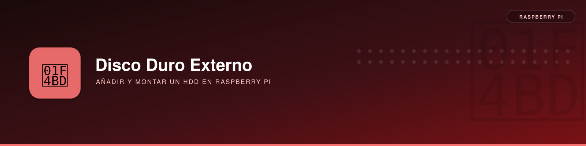

# Añadir un Disco Duro Externo



**Descripción**:  
Esta guía explica cómo conectar y configurar un disco duro externo en una Raspberry Pi. Aprenderás a identificarlo, conservar sus datos, formatearlo **solo si resulta necesario** en `ext4` y montarlo de forma automática en cada arranque.

!!! important "Montaje seguro y fallos eléctricos"
    Si el disco USB se desconecta o aparece como `0B`, comprobar primero **alimentación, sobrecorriente USB y cable**. En la Raspberry Pi 4 se documentó un caso real con recuperación al cambiar de USB 3.0 a USB 2.0: [diagnóstico de alimentación y montaje por UUID](diagnostico-usb.md). **No formatear un disco como respuesta a una desconexión USB.**

**Características principales**:  
- ✅ **Compatibilidad con distintos sistemas de archivos** - Se explican NTFS, FAT y `ext4`.  
- ✅ **Montaje automático** - Cómo hacer que el disco se monte cada vez que enciendas la Raspberry Pi.  
- ✅ **Configuración de permisos** - Asegura que los usuarios puedan leer y escribir en el disco.  

---

## Instalación

Antes de comenzar, verifica que tu Raspberry Pi tiene acceso al disco duro externo y que puedes ejecutar comandos de administración.

### Requisitos previos
- 📌 **Sistema operativo**: Raspberry Pi OS (o cualquier distribución basada en Linux).  
- 📌 **Acceso**: Se requieren permisos de `sudo`.  

### Comprobar la información del disco
Ejecuta el siguiente comando para verificar los dispositivos de almacenamiento conectados:

```bash
$ lsblk -fm
```
* `lsblk` informa sobre los dispositivos de almacenamiento.
* `-f` informa sobre los sistemas de archivos instalados.
* `-m` informa sobre quién es su propietario, su tamaño, etc.

Esto mostrará una lista de discos y particiones. Para identificar con certeza el sistema de archivos, el UUID y la partición:

```bash
lsblk -o NAME,SIZE,MODEL,FSTYPE,LABEL,UUID,MOUNTPOINTS
sudo blkid
```

!!! warning "Los nombres `/dev/sdX` pueden cambiar"
    No asumir que el HDD será siempre `/dev/sda` ni desmontar una partición sin identificarla. Si fuera necesario, desmontar **la partición concreta** (`sudo umount /dev/sdX1`) después de comprobar `lsblk`. Preferir UUID para montajes persistentes.

---

## Uso

### Opción corta: Montar un disco temporalmente
Si solo necesitas acceder al disco sin configurarlo de forma permanente:

```bash
# Crear punto de montaje
$ sudo mkdir -p /media/backup

# Montar la partición identificada previamente (ejemplo, sustituir sdX1)
$ sudo mount /dev/sdX1 /media/backup

# Comprobar que el montaje fue exitoso
$ lsblk -fm

# Desmontar antes de desconectarlo
$ sudo umount /media/backup
```

### Opción larga: Formatear y montar automáticamente
Si deseas integrar el disco a tu sistema de manera permanente:

#### Formatear en `ext4` (opcional y destructivo)

!!! danger "Se pierden TODOS los datos de la partición"
    Este paso solo se aplica si quieres borrar el contenido y crear un sistema de archivos nuevo. Si el disco ya tiene `ext4` (como el Toshiba del caso práctico), **omitirlo**. Antes, guardar copia de seguridad y contrastar modelo, capacidad, partición y UUID con `lsblk`.

```bash
# NO EJECUTAR hasta confirmar el dispositivo exacto y disponer de copia.
# Ejemplo ilustrativo: /dev/sdX1 representa UNA PARTICIÓN, no el disco entero.
sudo mkfs.ext4 -L datos /dev/sdX1
```

#### Establecer un punto de montaje

```bash
# Paso 1: Crea la carpeta donde se montará el disco:
$ sudo mkdir -p /media/backup

# Paso 2: Obtener el UUID del disco
$ lsblk -fm

# Paso 3 (opcional): Añade el disco a `/etc/fstab` para montaje automático al arranque del SO:
$ sudo vim /etc/fstab

```

En `/etc/fstab`, añade esta línea (sustituye **`TU-UUID`** por el UUID real de tu disco):

```fstab
UUID=TU-UUID /media/backup ext4 defaults,noatime,nofail,x-systemd.device-timeout=10s 0 2
```

Comprobar el cambio sin necesidad de reiniciar:

```bash
sudo systemctl daemon-reload
sudo mount /media/backup
findmnt /media/backup
lsblk -fm
```

Reiniciar cuando todo funcione y verificar de nuevo: `sudo reboot`.


### Modificación de permisos

Evitar `chmod 766`: concede escritura a otros usuarios y **no da permiso de recorrido** del directorio a grupo/otros. En una partición `ext4`, la propiedad y los permisos se gestionan como en cualquier directorio Linux.

```bash
# SOLO después de verificar que el HDD está montado
findmnt /media/backup || exit 1

# Crear una carpeta de datos que pertenezca al usuario actual
sudo mkdir -p /media/backup/datos
sudo chown "$USER:$USER" /media/backup/datos
sudo chmod 750 /media/backup/datos
```

No cambiar recursivamente propietario/permisos de todo el disco si contiene datos de otros usuarios o servicios. Si se usa NTFS/exFAT, los permisos suelen configurarse mediante opciones de montaje específicas.

### Evitar escrituras accidentales en la microSD

Con `nofail` el sistema puede arrancar sin el HDD. Sin una comprobación previa, un script podría guardar datos en la carpeta local que actúa como punto de montaje. Antes de cada proceso de captura:

```bash
mountpoint -q /media/backup || { echo 'Disco no montado'; exit 1; }
findmnt -no SOURCE,FSTYPE /media/backup
```

En automatizaciones críticas, además de comprobar el montaje, verificar el **UUID esperado** para no confundirlo con otra unidad. El caso real explica los [permisos del punto subyacente y el desmontaje](diagnostico-usb.md).

---

## Solución de problemas

**Error 1: El disco no se monta automáticamente**  

- Solución: Verifica que `/etc/fstab` está correctamente configurado y que el UUID es correcto.

**Error 2: No se tienen permisos para escribir en el disco**  

- Solución: Comprueba `findmnt`, `ls -ld /media/backup /media/backup/datos` y usa `chown`/`chmod` únicamente en el directorio de trabajo apropiado.

---


### Errores de E/S, reinicios del bus o disco de tamaño `0B`

La causa puede estar **antes del sistema de archivos**. Revisar `vcgencmd get_throttled`, `journalctl -k` y cables/alimentación; no ejecutar `mkfs` ni `fsck` sobre un disco que se desconecta. Caso real y pruebas: [diagnóstico HDD y USB](diagnostico-usb.md).

### El disco está ausente al arrancar

Las opciones `nofail,x-systemd.device-timeout=10s` evitan depender de la presencia de ese dispositivo para completar el arranque, pero **no garantizan disponibilidad de datos**. Comprobar el montaje dentro del script o servicio que vaya a guardar archivos.
